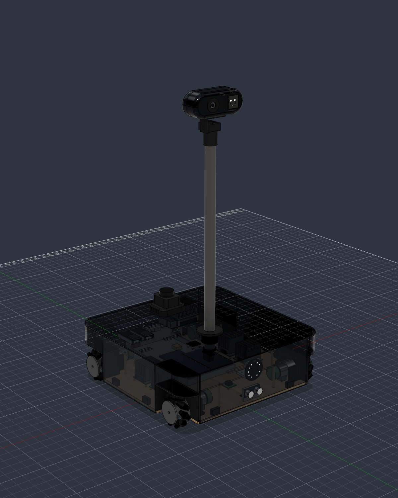
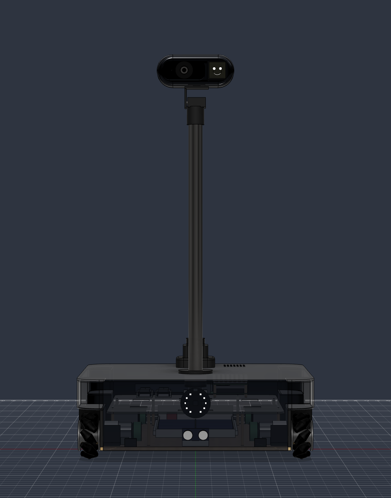
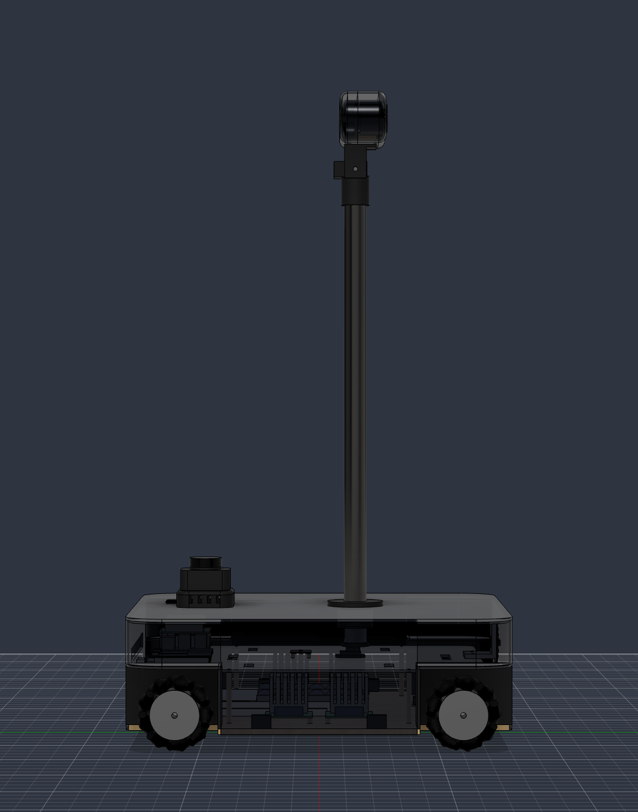
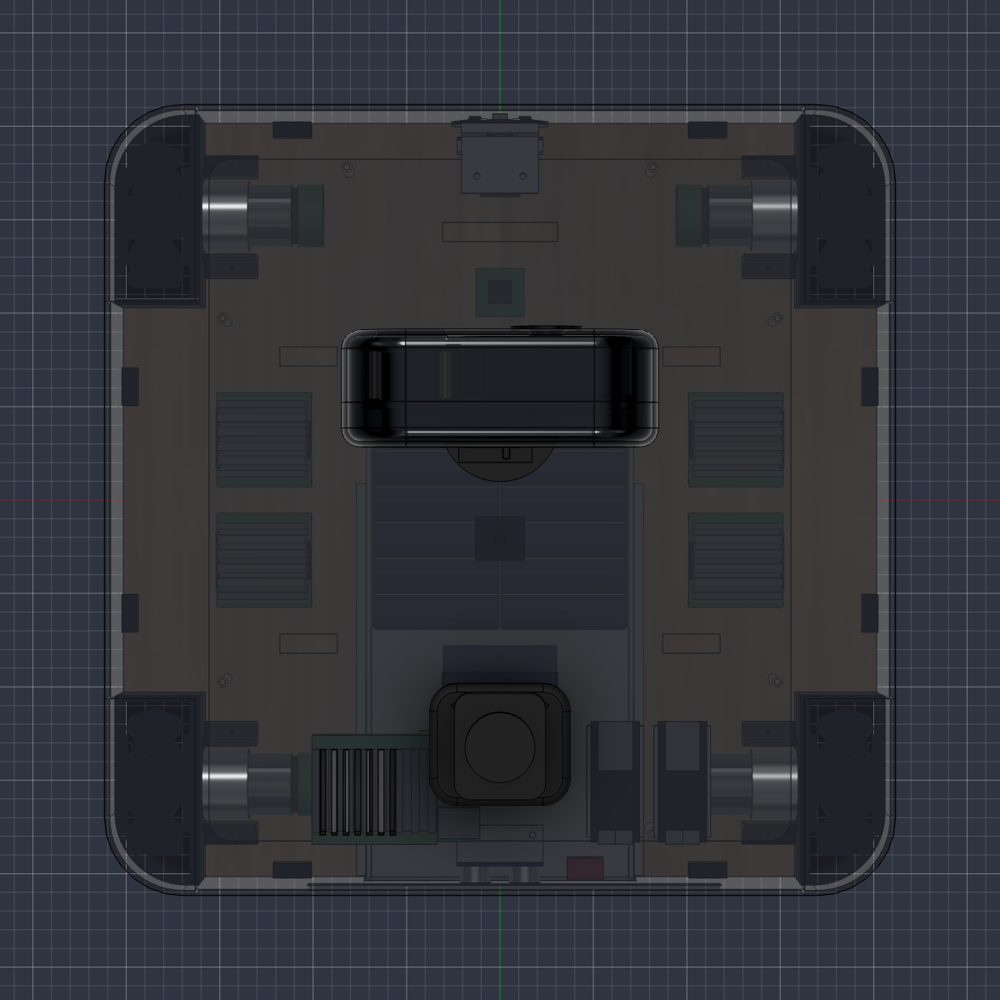

# Super bot, concept K, design v1

First buildable layout of concept K, designed in Autodesk Fusion. The Fusion design is **"Super bot - concept K blockout v1"** in Adam's *Default Project*. `super-bot-concept-k-v1.f3d` in this folder is an archive copy you can open in any Fusion install.

Every bought part sits in the model at its real size and mounting position, and the body, neck and head are sized around them. The design is parametric: change a user parameter (Modify → Change Parameters) and the chassis, shell, neck and head follow.

| Front | Side | Top |
| --- | --- | --- |
|  |  |  |

More views: [rear 3/4](k-v1-rear.png) (battery door, I/O window), [head close-up](k-v1-head.png), [body close-up](k-v1-body.png), and [K-proportion variant](k-v1-alt-short-neck.png) with `neck_len = 220 mm`.

## Headline numbers

- **Footprint:** 406 × 406 mm (40 × 40 cm plate plus 3 mm acrylic walls). Body top at 140 mm. Head top at **699 mm**.
- **Mass:** about 5.5 kg. Bought parts use their real masses, printed and cut parts use material density, and the wiring is estimated at 150 g.
- **Centre of gravity:** x −0.4, y −4.9, **z 99 mm**. It sits below the body top and between the decks. The static tip-over angle is about 56° to the rear and about 61° sideways (wheel contact patch ±182 × ±150 mm).
- **Interference between parts:** none. The analysis covered all 272 bodies, ignoring overlaps inside a single bought part, such as rollers inside a wheel.
- **Print bed:** all 41 printed parts fit a 256 × 256 × 256 mm bed.
- **Battery:** 3S4P 18650 (12 cells, 3000 mAh class), about 130 Wh nominal and about 0.6 kg. It lies flat in one layer at the centre of the base, on a sled that slides out the back.

## How it is built

- **Chassis:** a 400 × 400 × 6 mm birch-ply plate, CNC or laser cut, with four corner notches for the wheels. Ground clearance under the plate is 20 mm.
- **Drive:** four JGB37-520 motors sit on top of the plate, held by printed PETG mounts. Each mount's 5 mm face wall takes the gearbox's 6× M3 on Ø31 PCD, has a Ø13 hole for the shaft collar, and doubles as the wheel-well liner. A separate printed saddle supports the motor can. The 80 mm mecanum wheels are in X configuration, sit 2 mm inside the body line, and are visible through the open wheel wells.
- **Lower level (on the plate):**
  - The battery sled runs on two printed rails between the rear motors. Its rear face is the battery door, which carries the main rocker switch.
  - Behind the pack sit the BMS and an XT60.
  - Each BTS7960 sits next to its motor on 6 mm standoffs.
  - The 5 V buck converter sits at the front on two M2 standoffs.
  - The VL53L0X is screwed to the plate and looks down through a Ø10 hole in it.
  - The front HC-SR04 is clamped between the panel (its transducers sit in the panel holes) and a printed holder screwed to the plate. The rear one has a holder that hangs from the deck.
  - The BMS has no mounting holes, so it goes on the sled floor with foam tape.
- **Upper deck:** 3 mm clear acrylic on eight M3 × 54 mm standoffs. It carries:
  - the Pi 5 + Active Cooler + AI HAT+ 2 stack at the rear left. Its USB-C and micro-HDMI face the rear panel's I/O window. USB-A and Ethernet face right, with 56 mm free for the C270 plug;
  - both ESP32-S3 boards in printed cradles at the rear right, with their USB-C ports at the I/O window;
  - the BNO085 near the centre of rotation;
  - the pan servo, which drops through a cut-out with its tabs screwed to the deck.

  Six slots in the deck are the cable path between the levels.
- **Shell:**
  - The flat walls and the top are laser-cut 3 mm smoked acrylic.
  - The four corner fenders above the wheels are printed in smoked translucent PETG.
  - Panels stand on printed clips screwed to the plate.
  - The rear panel has a 215 × 16 mm I/O window for the Pi and ESP32 ports and an opening for the battery door. The ports sit about 22 mm inside, and plugs pass through the window.
  - The front and rear panels have holes for the HC-SR04 transducers.
  - The top has a hole for the neck hub, a lidar cable hole, and seven exhaust slots over the Pi.
- **Status ring:** the Circuit Playground Express sits behind the front panel at mid-height on a printed L-bracket hung from the deck. Its 10 NeoPixels are modelled as emissive LEDs and glow through the smoked acrylic.
- **Lidar backpack:** a printed, hollow, vented pod at the rear of the top carries the LD19. Its scan plane is at z ≈ 188 mm, clear of the body.
- **Neck:**
  - A 25 × 1 mm aluminium tube turns in two 6805 bearings inside a printed hub that clamps the top panel.
  - A clamp collar on the upper bearing carries the neck's weight, so the servo spline doesn't. A printed ring holds the lower bearing in.
  - An MG90S hanging in the deck drives the pan through a printed coupler.
  - At the top, a printed yoke holds a second MG90S for tilt (open-top pocket), and a printed bracket carries the head.
  - Cables run inside the tube and leave through a 12 mm slot between the coupler and the hub, below the bearings.
- **Head:**
  - The shell is a printed smoked PETG stadium, 136 × 56 × 50 mm, split into front and back halves.
  - A printed internal frame carries the 1.3" TFT on M2.5 standoffs. The C270 (clip removed) is clamped between the front shell and the frame by a 2.5 mm EVA pad.
  - The front has a lens hole with a black eye-ring bezel, and a TFT window with a 1 mm clear insert.
  - The TFT shows the face: two eyes and a smile, modelled as display content, not as parts.

## Clearances (from the Fusion measurement)

0.0 means two parts are deliberately in contact, bolted or seated together.

| Pair | Clearance |
| --- | --- |
| Wheel side plate ↔ motor-mount wall, ↔ plate notch | 2.0 mm |
| Wheel tyre ↔ fender underside | 8 mm (wheel top 80, fender 88) |
| Wheel ↔ wheel-well liner (front/rear wall) | 5 mm |
| Gearbox ↔ plate | 2.5 mm |
| BTS7960 heatsink ↔ upper deck | 5.0 mm |
| Fender ↔ upper deck | 6.7–8.0 mm |
| AI HAT+ 2 heatsink ↔ top panel | about 15 mm (air gap for the cooler) |
| Battery cells ↔ upper deck | about 32 mm (BMS and leads, set by driver height) |
| Sled rail ↔ deck standoff | 1.15 mm (tight) |
| CPX USB connector ↔ front panel | 0.9 mm |
| HC-SR04 transducer ↔ panel hole (radial) | 0.3 mm |
| ESP32 cradle A ↔ B | 5.6 mm |
| C270 ↔ TFT inside the head | 4.0 mm |
| Pi USB-A ↔ ESP32-A cradle (C270 plug space) | 56 mm |
| Neck cable slot | z 103–115 mm, between the coupler (top 99.5) and the bearing ring (116) |

## Fit issues and open points

1. **Height versus the concept image.** The brief asked for the head top at 70–90 cm while staying proportionate to concept K. Those conflict. K's neck is short, and at 70 cm the robot reads more like concept L. The default is `neck_len = 480 mm`, giving a 699 mm head top at the low end of the range. Setting `neck_len = 220 mm` gives about 44 cm and K's proportions (see `k-v1-alt-short-neck.png`). This needs Adam's call.
2. **The lidar sees the neck.** The 25 mm tube is 165 mm in front of the lidar and blocks about 9° of the scan. Mask that sector in software, or move the lidar onto a taller mast later.
3. **Sheet size.** The top panel (406 × 406) and the plate (400 × 400) need a laser or CNC bed of at least 410 mm, or a cutting service. The front and rear panels (313 × 117), the sides (204 × 117) and the deck (304 × 356) fit common 400 × 300+ lasers.
4. **The front half of the upper deck is mostly free.** The 40 × 40 footprint is bigger than today's parts need, while the height is tight. That space is the natural home for the audio parts on the page (INMP441 mic, MAX98357A, speaker), which are not modelled yet, and for the future arm base.
5. **Battery access.** The sled slides out the rear. The XT60 lead needs about 5 cm of slack to unplug once the sled is part-way out. A blind-mate connector would be cleaner later.
6. **Cooling is designed in, not simulated.** Air comes in through the I/O window and the open wheel wells and leaves through the top slots over the Pi. The BTS7960s sit only 5 mm under the deck, which is fine at normal currents. Check temperatures on the first long drive.
7. **The servos carry the head directly.** The tilt MG90S carries about 170 g at about 30 mm. That's within its torque, but there is no slip clutch, so a knock to the head goes straight into the gears.
8. **Panel retention.** Acrylic panels bond (VHB or acrylic cement) to the printed clips and fenders. Top-panel magnets and the head-half screws are noted but not modelled.
9. **Not checked:** the full pan and tilt sweep (only the rest pose was checked for interference), thermals, and real plug and cable bend space beyond the clearances above.
10. **Estimated dimensions** (marked EST below) should be measured when the parts arrive. If any is off, change the parameter.

## What is final and what is a placeholder

**Final for building v1 (re-check the EST dimensions):** the chassis plate outline, wheel and motor positions, motor mounts and wheel-well liners, motor saddles, battery sled and door, upper deck and standoff pattern, board positions and mounting holes, shell panel split, corner fenders, panel clips, I/O window, CPX bracket, lidar backpack, neck architecture (tube, bearings, hub, coupler, yoke, head bracket), head shell split and internal frame.

**Placeholders (not in the 17 Nov parts list, or not chosen yet):**
- 2× MG90S servos for pan and tilt. They are on the page's to-buy list but not in the 17 Nov decisions. **Needs OK.**
- 2× 6805 bearings (25 × 37 × 7) and the 25 mm neck clamp collar.
- 5 V buck converter, Pololu D36V50F5. A 3S pack can't power a Pi 5 without one.
- Main rocker switch (KCD1) and the XT60 pair. A fuse is still to be added.
- BMS footprint (3S 40A class, 60 × 41 mm; listings disagree).
- Cable harness: only the path is modelled (deck slots, neck tube, exit slot).
- Audio, arm and dock: not modelled.
- Face graphic: display content only.
- Lidar: the LD19 is modelled. Its three backpack holes are approximate: check them against the part. The LD06 is smaller and fits the same backpack with a different hole pattern.
- VL53L0X hole spacing (EST).

## Parts and dimensions

SRC = from the source listed. EST = estimated, measure on arrival.

| Part | Modelled size (mm) | Source |
| --- | --- | --- |
| Raspberry Pi 5 8 GB | PCB 85 × 56 × 1.4. Holes 58 × 49, 3.5 from edges. USB stack 16.8 high, RJ45 13.7. USB-C at 11.2, HDMI at 25.8 / 39.2 from the left edge | SRC [RPi mechanical drawing](https://pip.raspberrypi.com/documents/RP-008347-DS-raspberry-pi-5-mechanical-drawing.pdf). Heights M, thickness EST |
| Active Cooler | 63.5 × 42.5 × 13.7, 30 mm fan | SRC [drawing](https://datasheets.raspberrypi.com/cooling/raspberry-pi-active-cooler-mechanical-drawing.pdf) |
| AI HAT+ 2 (Hailo-10H) | 65 × 56.5 PCB on 16 mm spacers. Heatsink 64 × 42.5 × 14 | SRC [product brief](https://pip.raspberrypi.com/documents/RP-009655-MM-raspberry-pi-ai-hat-plus-2-product-brief.pdf). Heatsink height EST |
| ESP32-S3-DevKitC-1 v1.1 | 62.74 × 25.4. Two USB-C on one short edge. No mounting holes, so printed cradles | SRC [Espressif DXF](https://dl.espressif.com/dl/schematics/esp_idf/DXF_ESP32-S3-DevKitC-1_V1.1_20220429.pdf). Height EST |
| BTS7960 (IBT-2) ×4 | 50 × 50, 43 high with heatsink, holes on 45 mm centres | SRC/M [handsontec](https://www.handsontec.com/dataspecs/module/BTS7960%20Motor%20Driver.pdf). Height varies by seller |
| 18650 cell ×12 (3S4P) | Ø18.6 × 65.2. Pack 134.4 × 114.6 × 21.1, one layer | SRC [MDPI](https://www.mdpi.com/2313-0105/4/3/45). Pack envelope EST |
| BMS 3S 40A | 60 × 41 × 3.4 | M [datasheet](https://static.elitesecurity.org/uploads/3/9/3933344/BMS-40A-3S_SGT.pdf) |
| BNO085 (Adafruit 4754) | 25.6 × 22.7, holes 20.32 × 17.78 | SRC [Adafruit](https://www.adafruit.com/product/4754) |
| Logitech C270 | 72.9 × 31.9 body, 25 deep without the clip | SRC [Logitech spec](https://www.logitech.com/assets/46735/2/hd-webcam-c270.pdf). Depth EST |
| 1.3" TFT (Adafruit 4313) | 35.8 × 35.8 × 5.3, active area about 23.4 | SRC [Adafruit](https://www.adafruit.com/product/4313) |
| Circuit Playground Express | Ø50.8. 10 NeoPixels (3535) on r = 17.15 at 0/30/60/120/150/180/210/240/300/330° | SRC [Adafruit PCB files](https://github.com/adafruit/Adafruit-Circuit-Playground-Express-PCB) |
| LDROBOT LD19 | 54 × 46.29 × 34.8, head Ø35.29 × 12.6 | SRC [datasheet](https://www.elecrow.com/download/product/SLD06360F/LD19_Datasheet_V1.0.pdf) |
| JGB37-520 + encoder ×4 | Gearbox Ø37 × 24 (56:1–90:1). Can Ø33 × 22.7, cap 3.5, encoder 13. 6 mm D-shaft 15.5 long, offset 7. 6× M3 on Ø31 | SRC [datasheet](https://pdf.direnc.net/upload/jgb37-520-datasheet.pdf). Encoder EST, offset M |
| Mecanum wheel 80 mm ×4 | Ø80 × 37.5, 9 rollers at 45° | SRC [handsontec](https://handsontec.com/dataspecs/robotics/Mecanum%20Wheel.pdf). Roller shape EST |
| HC-SR04 ×2 | PCB 45 × 20, transducers Ø16 × 12, 26 apart | SRC [datasheet](https://cdn.sparkfun.com/datasheets/Sensors/Proximity/HCSR04.pdf) |
| VL53L0X (Adafruit 3317) | 21 × 18 × 2.8 | SRC [Adafruit](https://www.adafruit.com/product/3317) |
| MG90S ×2 (placeholder) | 22.8 × 12.2 × 28.5, tabs 32.5 | SRC [TowerPro](https://towerpro.com.tw/product/mg90s-3/). Shaft position EST |
| Pololu D36V50F5 (placeholder) | 25.4 × 25.4 × 9.5 | SRC [Pololu](https://www.pololu.com/product/4091) |

## Power budget (estimates)

Pack: 3S4P of 3000 mAh cells = 12 Ah × 10.8 V ≈ **130 Wh nominal, about 110 Wh usable** (stopping at about 3.3 V per cell). 3500 mAh cells add about 17 %. The 5 V loads go through the buck converter at about 90 % efficiency.

| Load | Awake, standing still | Driving |
| --- | --- | --- |
| Pi 5 (vision + controller) | 6 W | 6 W |
| AI HAT+ 2 running YOLO | 3 W | 3 W |
| LD19 lidar | 1.2 W | 1.2 W |
| C270 | 0.5 W | 0.5 W |
| 2× ESP32-S3 | 0.8 W | 0.8 W |
| TFT, CPX, BNO085, HC-SR04, VL53L0X | 0.7 W | 0.7 W |
| Pan/tilt servos | 0.3 W | 1 W |
| 5 V subtotal ÷ 0.9 | **13.9 W** | **14.7 W** |
| 4× JGB37 at 12 V (no-load draw about 0.12 A each, plus rolling, turns and strafing on mixed floor) | — | about 20 W average |
| **Total from the pack** | **≈ 14 W** | **≈ 35 W** |

- **Awake but standing still:** about 110 / 14 ≈ **8 h**.
- **Continuous driving:** about 110 / 35 ≈ **3 h**.
- **Typical mix** (20 % driving, 80 % awake): about 18 W average, so about **6 h**.
- **Deep idle** (Pi idling, Hailo and lidar off): about 6.5 W, so about **17 h**.

These are estimates. The motor figure is the most uncertain, so log real current on the first drives. Peak current with four motors near stall is well within a 4P pack and a 40A BMS, but add a fuse at the pack.

Adam's note said 3S4P is about 0.6 kg more than 3S2P. The real difference is about 0.3 kg: six more cells at about 47 g each. The whole 3S4P pack is about 0.6 kg.

## Parameters

Lengths in mm. Change them in Fusion under Modify → Change Parameters.

| Name | Expression | Value | Meaning |
| --- | --- | --- | --- |
| `plate_w` | 400 mm | 400.0 | Chassis plate X (DIY 40x40 plate, birch ply) |
| `plate_d` | 400 mm | 400.0 | Chassis plate Y |
| `plate_t` | 6 mm | 6.0 | Plate thickness (6 mm birch ply) |
| `plate_z` | 20 mm | 20.0 | Ground clearance under the plate |
| `plate_top` | plate_z + plate_t | 26.0 | Top of plate |
| `wall_t` | 3 mm | 3.0 | Shell panel thickness (3 mm smoked acrylic) |
| `pwall` | 2.4 mm | 2.4 | Printed part wall (6 perimeters @0.4) |
| `shell_x` | plate_w / 2 + wall_t | 203.0 | Outer half-width of body |
| `shell_y` | plate_d / 2 + wall_t | 203.0 | Outer half-depth of body |
| `body_top` | 140 mm | 140.0 | Top of body above ground |
| `corner_r` | 40 mm | 40.0 | Plan-view corner radius of the body |
| `wheel_d` | 80 mm | 80.0 | Mecanum wheel OD (SRC handsontec/dfrobot) |
| `wheel_w` | 37.5 mm | 37.5 | Mecanum wheel width (SRC) |
| `wheel_y` | 150 mm | 150.0 | Wheel centre \|Y\| = half wheelbase |
| `wheel_x_out` | shell_x - 2 mm | 201.0 | Wheel outer face \|X\| (tucked 2 mm inside body) |
| `wheel_xc` | wheel_x_out - wheel_w / 2 | 182.25 | Wheel centre \|X\| |
| `well_gap` | 2 mm | 2.0 | Wheel to wheel-well wall gap |
| `mount_wall` | 5 mm | 5.0 | Printed motor mount wall |
| `notch_x` | wheel_x_out - wheel_w - well_gap | 161.5 | Plate wheel notch starts at \|X\| |
| `notch_y` | wheel_y - wheel_d / 2 - 5 mm | 105.0 | Plate wheel notch starts at \|Y\| |
| `gb_face` | notch_x - mount_wall | 156.5 | JGB37 gearbox face \|X\| |
| `axle_z` | wheel_d / 2 | 40.0 | Wheel axle height |
| `shaft_off` | 7 mm | 7.0 | JGB37 output shaft offset from motor axis (SRC, M) |
| `motor_z` | axle_z + shaft_off | 47.0 | Motor axis height (shaft below axis) |
| `gb_d` | 37 mm | 37.0 | JGB37 gearbox dia (SRC) |
| `gb_len` | 24 mm | 24.0 | JGB37 gearbox length, 56:1-90:1 (SRC) |
| `can_d` | 33 mm | 33.0 | JGB37 motor can dia (SRC) |
| `can_len` | 22.7 mm | 22.7 | JGB37 motor can length (SRC) |
| `cap_len` | 3.5 mm | 3.5 | JGB37 rear cap (SRC) |
| `enc_len` | 13 mm | 13.0 | Hall encoder length (EST) |
| `collar_len` | 6 mm | 6.0 | Shaft collar (SRC) |
| `shaft_len` | 15.5 mm | 15.5 | 6 mm D-shaft length (SRC) |
| `fender_z` | wheel_d + 8 mm | 88.0 | Underside of the wheel fender |
| `cell_d` | 18.6 mm | 18.6 | 18650 cell dia (SRC 18.3-18.6) |
| `cell_l` | 65.2 mm | 65.2 | 18650 cell length, unprotected flat-top (SRC) |
| `pack_x` | 2 * cell_l + 4 mm | 134.4 | 3S4P pack X: 2 cells end to end + nickel/holders |
| `pack_y` | 6 * cell_d + 3 mm | 114.6 | 3S4P pack Y: 6 cells side by side + wrap |
| `pack_h` | cell_d + 2.5 mm | 21.1 | 3S4P pack height (single flat layer, lowest CoG) |
| `pack_yc` | -12 mm | -12.0 | Pack centre Y (sled must fit a 256 mm bed) |
| `sled_floor` | 2 mm | 2.0 | Battery sled floor |
| `deck_z` | 80 mm | 80.0 | Upper deck underside |
| `deck_t` | 3 mm | 3.0 | Upper deck (3 mm clear acrylic) |
| `deck_top` | deck_z + deck_t | 83.0 | Upper deck top |
| `deck_x` | 152 mm | 152.0 | Upper deck half-width |
| `deck_y` | 178 mm | 178.0 | Upper deck half-depth |
| `drv_x` | 125 mm | 125.0 | BTS7960 centre \|X\| |
| `drv_y` | 32 mm | 32.0 | BTS7960 centre \|Y\| |
| `drv_so` | 6 mm | 6.0 | BTS7960 standoff height |
| `pi_xc` | -55 mm | -55.0 | Pi 5 PCB centre X |
| `pi_yc` | -150 mm | -150.0 | Pi 5 PCB centre Y |
| `pi_so` | 6 mm | 6.0 | Pi 5 standoffs on deck |
| `pi_z` | deck_top + pi_so | 89.0 | Pi 5 PCB underside |
| `hat_so` | 16 mm | 16.0 | AI HAT+ 2 stacking header / spacer height (SRC) |
| `cpx_z` | 100 mm | 100.0 | CPX status ring centre height on the front face |
| `neck_y` | 40 mm | 40.0 | Neck axis Y (forward of centre, like concept K) |
| `lidar_y` | -125 mm | -125.0 | Lidar centre Y on the rear backpack |
| `pack_h_ped` | 18 mm | 18.0 | Lidar backpack height above the top panel |
| `door_w` | pack_x + 8 mm | 142.4 | Battery door width |
| `neck_od` | 25 mm | 25.0 | Neck tube OD (25x1 aluminium tube, cables inside) |
| `neck_id` | 23 mm | 23.0 | Neck tube ID (C270 USB-A plug passes) |
| `neck_len` | 480 mm | 480.0 | Neck: top panel to tilt axis. Sets overall height |
| `tilt_z` | body_top + neck_len | 620.0 | Head tilt axis height |
| `head_w` | 136 mm | 136.0 | Head width (C270 + TFT side by side, inside the straight section) |
| `head_h` | 56 mm | 56.0 | Head height |
| `head_d` | 50 mm | 50.0 | Head depth |
| `head_yc` | neck_y + 8 mm | 48.0 | Head centre Y |
| `head_zc` | tilt_z + 27 mm + head_h / 2 | 675.0 | Head centre Z |
| `c270_w` | 72.9 mm | 72.9 | C270 body width without clip (SRC 72.91) |
| `c270_h` | 31.9 mm | 31.9 | C270 body height (SRC 31.91) |
| `c270_d` | 25 mm | 25.0 | C270 body depth without clip (EST) |
| `tft_s` | 35.8 mm | 35.8 | Adafruit 4313 1.3in 240x240 TFT board (SRC) |
| `tft_t` | 5.3 mm | 5.3 | TFT board thickness (SRC) |

The rollers on each wheel are a base feature: they are fixed geometry and don't follow parameter changes. Everything else follows. Changing `body_top` from 140 to 170 and `neck_len` from 480 to 300 left the timeline fully healthy.

## Files

- `super-bot-concept-k-v1.step`: the whole robot as an assembly.
- `super-bot-concept-k-v1.f3d`: Fusion archive.
- `stl/`: one STL per printed part and per shell piece (fenders, panels, top, backpack, head halves, mounts, sled, clips, neck parts). Identical parts share one file, so print **8× `clip`** and **2× `sled-rail`**. Left and right parts are separate files because they are mirrored. Print in PETG: smoked translucent for the fenders, backpack and head shell, black for the rest. The TFT window insert is better cut from 1 mm clear acrylic than printed.
- `dxf/`: outlines of the laser- or CNC-cut sheets (plate, deck, acrylic panels). Cut **2× `side-panel`**. The STLs of the acrylic panels are there for visual checks only.
- `k-v1-*.png`: viewport images.
- `scripts/`: the Fusion API scripts that built the design, run through the Fusion MCP. `sblib.py` holds the helpers. Stages `s1`–`s5` build the model, and `checks.py` runs interference, clearance, mass and bed fit. `fix_*.py` were one-off repairs that are now folded into the stage scripts. To rebuild from an empty design, run `s1` → `s2` → `s3` → `s4` → `s5` in that order (each loads `sblib.py` first), then `looks.tune_looks()`. Scripts with `fresh()` delete and recreate their own components, so a single stage can be re-run, but re-run `s5` after `s1`'s `chassis()` or `s2`'s `deck()`.
