# Concept K v1: parts diagram and honest review

v1 is frozen. The Fusion design "Super bot - concept K blockout v1" stays as it is. An exact copy is saved as **"Super bot - concept K v1 (backup)"** (both are in Default Project), and the repo is tagged `concept-k-v1`. Nothing here changes v1; this is the map of what's in it and what I'd change.

## Adam's decisions (17 Nov 2026)

These apply to **v2**; the v1 model stays as it is. They are also recorded in [docs/decisions.md](../../../docs/decisions.md).

**Accepted:**
- Cliff sensors on all 4 sides.
- INA226 battery monitor.
- Mic (INMP441) + MAX98357A amp + speaker.
- HC-SR04 level shifting (or the HC-SR04P).
- Start with 1 ESP32-S3.
- 15 A main fuse.
- DC-rated main switch instead of the KCD1.
- Separate 5–6 V servo supply.
- Pi 5 set to 5 A, with the buck converter next to it.
- Pi Camera Module 3 instead of the C270.
- DRV8874-class motor drivers.
- Drive: JGB37-520 12 V **530 rpm** with **100 mm** mecanum wheels. See [section 5](#5-speed-check-530-rpm-motors-with-100-mm-wheels).
- Safety without an e-stop: software speed and acceleration limits, plus bumpers.
- The placeholder parts (MG90S servos, 6805 bearings + collar, Pololu buck) are approved.

**Pending:** removing the rear HC-SR04, the shell material, and the neck. All of these come with the v2 torso (30 × 30 cm, taller, stacked levels).

## 1. Pictures

Every orange number matches a row in the parts table below.

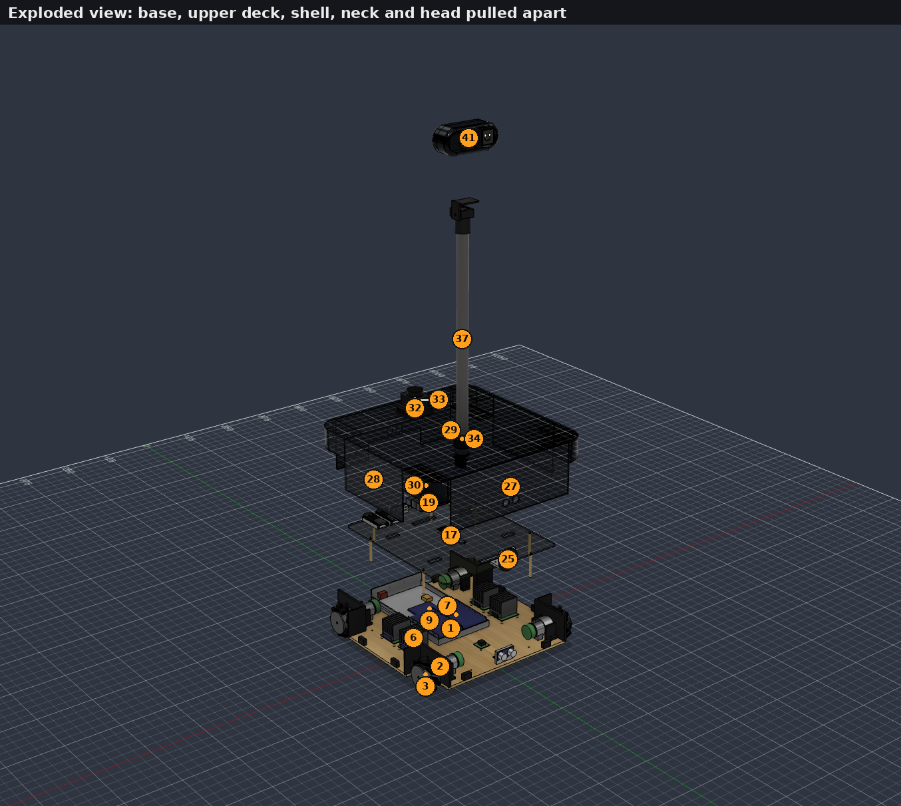

| Base level | Upper deck |
| --- | --- |
| 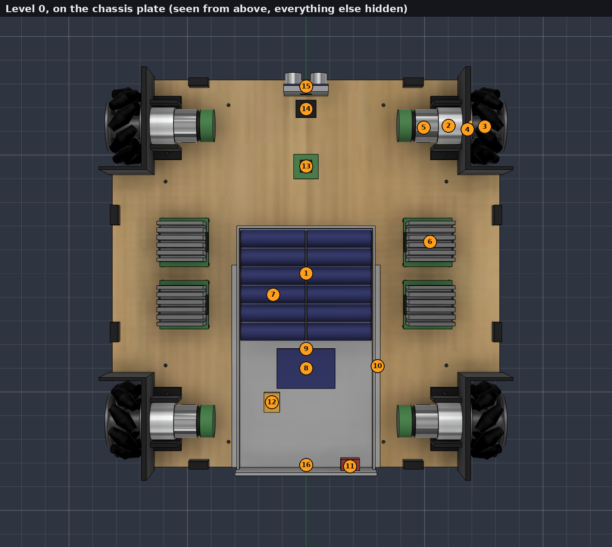 | 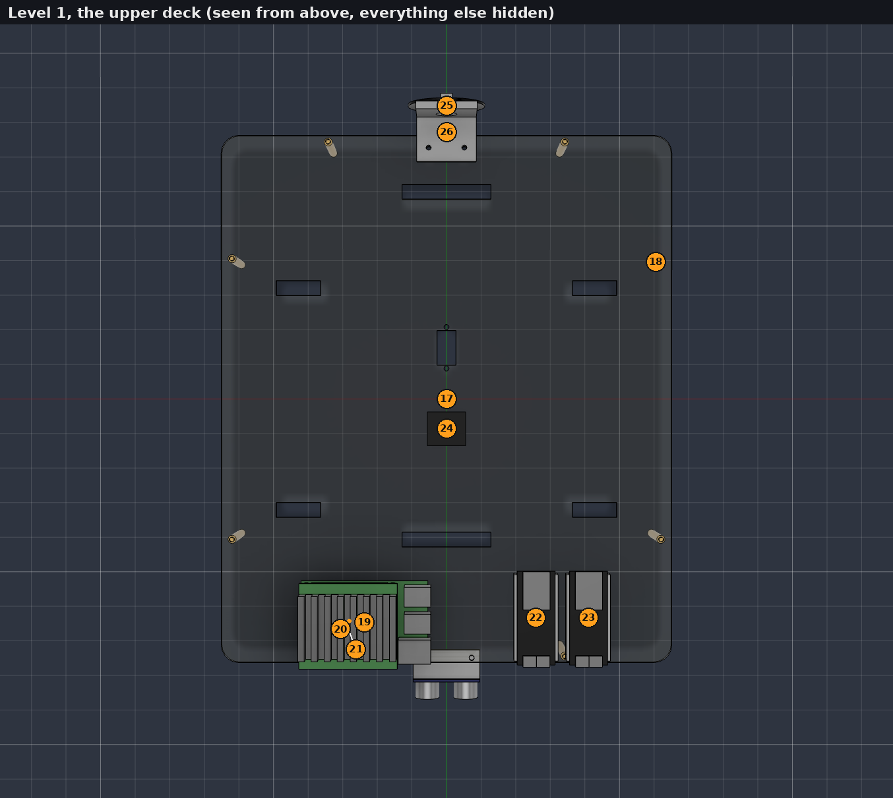 |

| Neck base | Head | Front |
| --- | --- |--- |
| 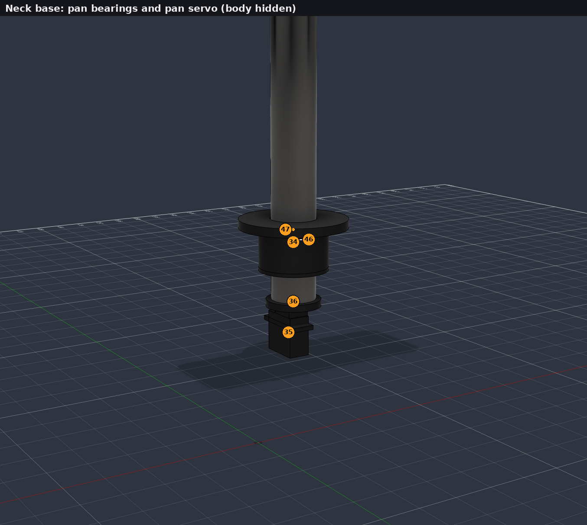 | 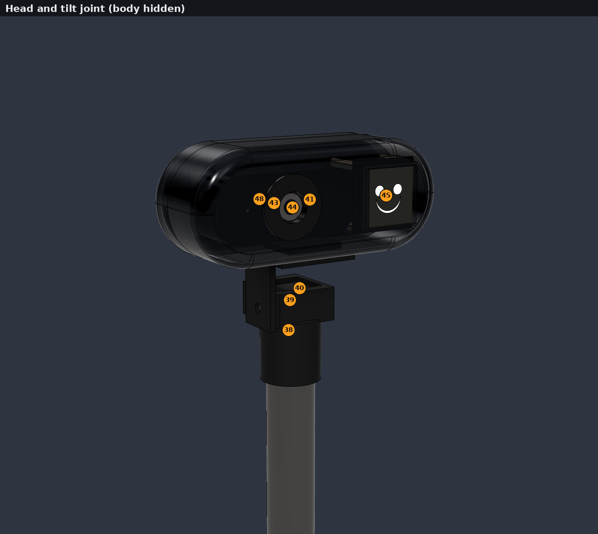 | 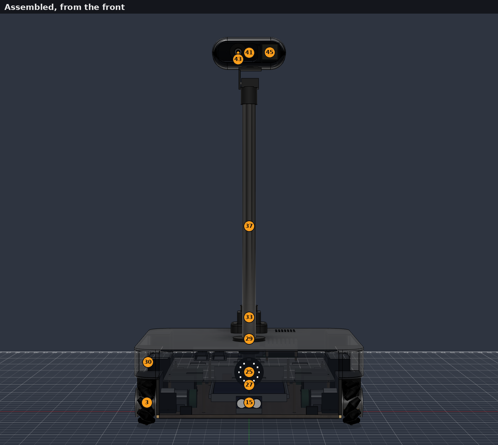 |

## 2. Every part

Types:
- **Bought:** you buy it ready-made.
- **Printed:** 3D printed in PETG.
- **Cut:** laser- or CNC-cut from sheet.
- **Placeholder (OK'd):** Adam approved it on 17 Nov, but the exact model can still change.

"×4" means there are four of them; the picture labels one.

| # | Part | What it is | What it does | Where it sits | Type |
| --- | --- | --- | --- | --- | --- |
| 1 | Chassis plate | 400 × 400 × 6 mm birch plywood | The floor everything bolts to | Bottom of the robot, 20 mm above the ground | Cut |
| 2 | JGB37-520 motor ×4 | 12 V gear motor with a magnetic encoder on the back | Turns one wheel; the encoder counts how far it turned | One per corner, lying on the plate | Bought |
| 3 | 80 mm mecanum wheel ×4 | Wheel with 9 rollers at 45° | Lets the robot drive in any direction, including sideways | Corners, tucked under the fenders | Bought |
| 4 | Motor mount + wheel-well liner ×4 | Printed wall with the motor's 6 screw holes | Holds the motor and closes off the wheel well | Corners, between motor and wheel | Printed |
| 5 | Motor saddle ×4 | Small printed cradle | Supports the back end of each motor | Under each motor | Printed |
| 6 | BTS7960 motor driver ×4 | Big H-bridge board with a heatsink | Turns the ESP32's signals into motor power | Left and right, beside the battery | Bought |
| 7 | 18650 battery pack 3S4P | 12 lithium cells in one flat layer, about 130 Wh | Powers everything | Centre of the base, as low as possible | Bought (cells) |
| 8 | BMS 3S 40A | Battery protection board | Stops over-charge, over-discharge and short circuits | On the sled, behind the cells | Bought |
| 9 | Battery sled + door | Printed tray; its back face is the door | Slides the battery out the back | Centre of the base | Printed |
| 10 | Sled rails ×2 | Printed strips | Guide the sled in and out | On the plate, either side of the sled | Printed |
| 11 | Main switch | KCD1 rocker switch | Turns the robot on and off | On the battery door | Placeholder |
| 12 | XT60 connector | Standard battery plug | Lets you unplug the battery | Inside, behind the BMS | Placeholder |
| 13 | 5 V buck converter (Pololu D36V50F5) | Voltage converter, 12 V to 5 V, about 5.5 A | Powers the Pi and the 5 V parts | Front of the plate | Placeholder (OK'd) |
| 14 | VL53L0X | Tiny laser distance sensor | Looks at the floor to spot stairs and edges | Front of the plate, looking down through a hole | Bought |
| 15 | HC-SR04, front, + holder | Ultrasonic distance sensor | Measures distance ahead, and sees glass the lidar misses | Front panel, low | Bought + printed |
| 16 | HC-SR04, rear, + holder | Same | Measures distance behind | Rear panel, above the battery door | Bought + printed |
| 17 | Upper deck | 3 mm clear acrylic shelf | Second level for the computers | 80 mm above the ground | Cut |
| 18 | Deck standoffs ×8 | M3 × 54 mm brass posts | Hold the deck up | Between plate and deck | Bought |
| 19 | Raspberry Pi 5 8 GB | The main computer | Runs vision, the controller and talks to the cloud brain | Rear left of the deck | Bought (owned) |
| 20 | Active Cooler | Fan and heatsink for the Pi | Keeps the Pi cool | On the Pi | Bought |
| 21 | AI HAT+ 2 (Hailo-10H) | AI accelerator board | Runs YOLO fast so the Pi doesn't have to | Stacked on the Pi | Bought (later) |
| 22 | ESP32-S3 A + cradle | Small fast microcontroller | Motors, encoders and reflexes (about 1 kHz) | Rear right of the deck | Bought + printed |
| 23 | ESP32-S3 B + cradle | Same | Sensors, servos and status | Next to A | Bought + printed |
| 24 | BNO085 | Motion sensor (IMU) | Knows which way is up and how the robot is turning | Middle of the deck | Bought |
| 25 | Circuit Playground Express | Round board with 10 RGB LEDs | Status light ring and backup watchdog | Behind the front panel, mid-height | Bought (owned) |
| 26 | CPX bracket | Printed L-bracket | Holds the CPX behind the panel | Hangs from the deck front | Printed |
| 27 | Front and rear panels | 3 mm smoked acrylic | Walls you can see the electronics through | Front and back of the body | Cut |
| 28 | Side panels ×2 | Same | Side walls | Left and right | Cut |
| 29 | Top panel | 406 × 406 mm smoked acrylic | Roof; carries the neck and the lidar | Top of the body | Cut |
| 30 | Corner fenders ×4 | Printed smoked shells | Cover the wheels and round off the corners | Above each wheel | Printed |
| 31 | Panel clips ×8 | Small printed blocks | Hold the panels to the plate | Inside the bottom edge of the walls | Printed |
| 32 | Lidar backpack | Printed vented pod | Raises the lidar above the body | Rear of the top | Printed |
| 33 | LD19 lidar | Spinning laser scanner | Maps the room in 360° | On the backpack | Bought (later) |
| 34 | Pan bearing hub | Printed housing | Holds the neck bearings in the top panel | Top panel, front of centre | Printed |
| 35 | Pan servo (MG90S) | Small metal-gear servo | Turns the neck left and right | Hanging in a cut-out in the deck | Placeholder (OK'd) |
| 36 | Pan coupler | Printed disc | Joins the servo to the neck tube | Bottom of the tube | Printed |
| 37 | Neck tube | 25 × 1 mm aluminium tube, about 0.5 m | The neck; cables run inside it | From the body up to the head | Bought (cut to length) |
| 38 | Tilt yoke | Printed block | Holds the tilt servo at the top of the neck | Top of the tube | Printed |
| 39 | Tilt servo (MG90S) | Same as 35 | Tilts the head up and down | Inside the yoke | Placeholder (OK'd) |
| 40 | Head bracket | Printed L-plate | Connects the tilt servo to the head | Under the head | Printed |
| 41 | Head shell, front + back | Printed smoked stadium shape, 136 × 56 × 50 mm | The head's skin | Top of the robot | Printed |
| 42 | Head frame | Printed plate | Holds the TFT and clamps the camera | Inside the head | Printed |
| 43 | Logitech C270 | USB webcam, clip removed | The robot's eye for vision | Right side of the face (your left when facing it) | Bought |
| 44 | Eye-ring bezel | Printed black ring | Makes the camera look like an eye | Around the camera lens | Printed |
| 45 | 1.3" TFT (240 × 240) + window | Small colour screen behind a clear window | Shows the face (eyes and smile) | Left side of the face (your right when facing it) | Bought + cut |
| 46 | 6805 bearings ×2 | Ball bearings, 25 × 37 × 7 mm | Let the neck spin smoothly and take side loads | Inside the pan hub | Placeholder (OK'd) |
| 47 | Neck clamp collar | 25 mm shaft collar | Rests the neck's weight on the top bearing, not on the servo | On the tube, inside the hub | Placeholder (OK'd) |
| 48 | Camera foam pad | 2.5 mm EVA foam | Clamps the C270 gently | Behind the camera | Bought (cut) |

### Close-up callouts

One picture per area, with leader lines from each label to the actual part. Shells are shown see-through where they would hide the inside. Labels marked "decision:" point to the changes Adam accepted for v2.

| | |
| --- | --- |
| 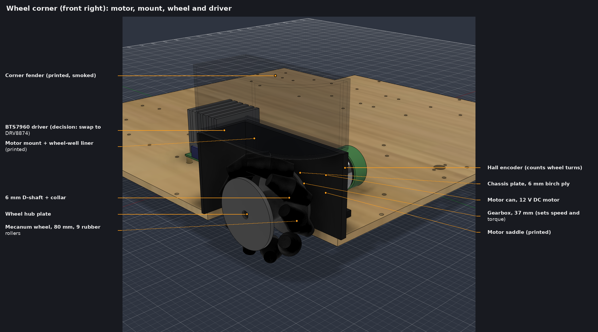 | 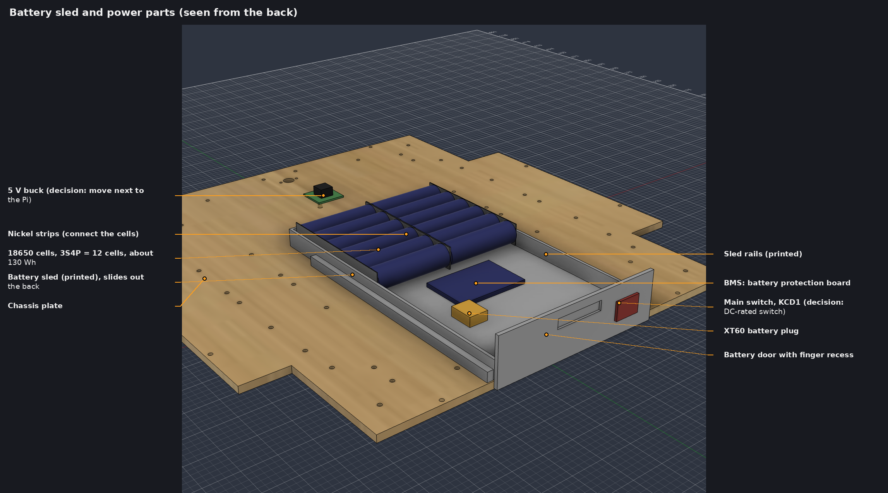 |
| 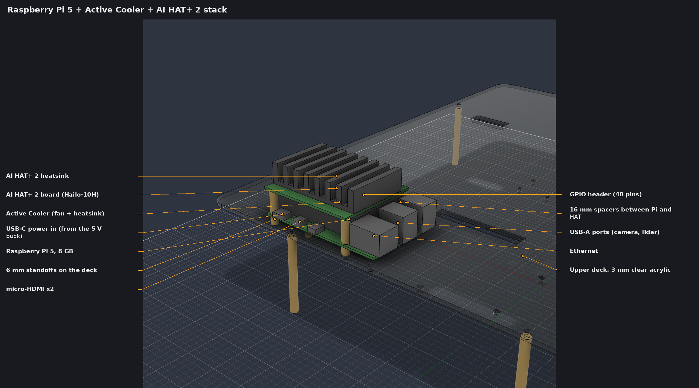 | 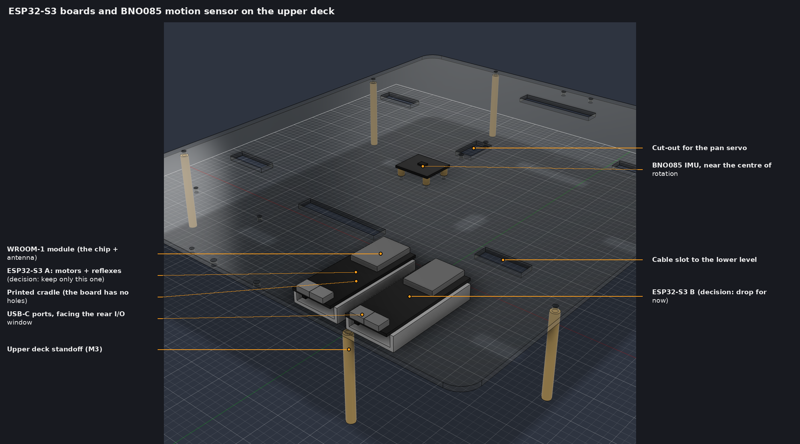 |
| 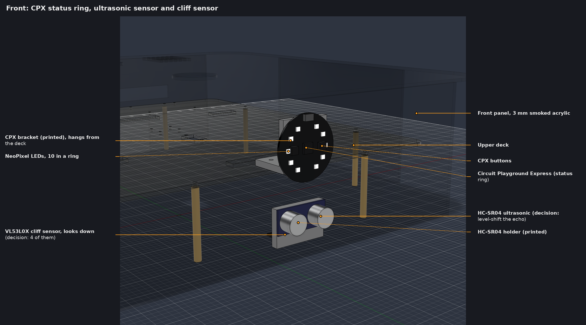 | 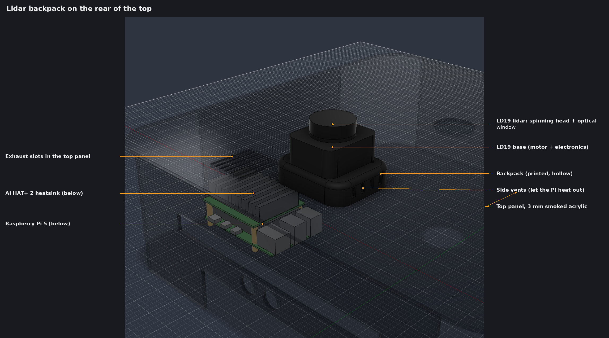 |
| 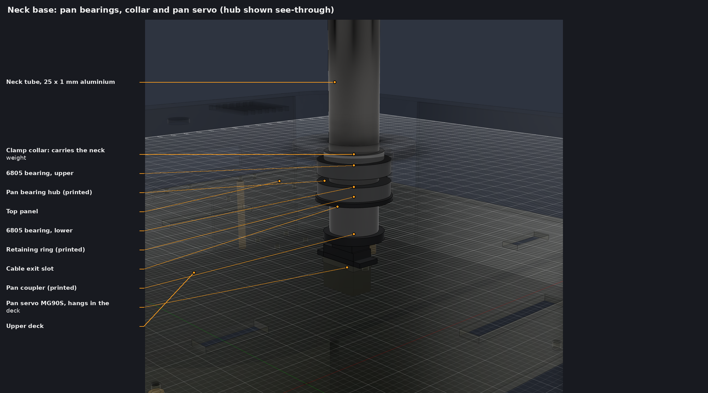 | 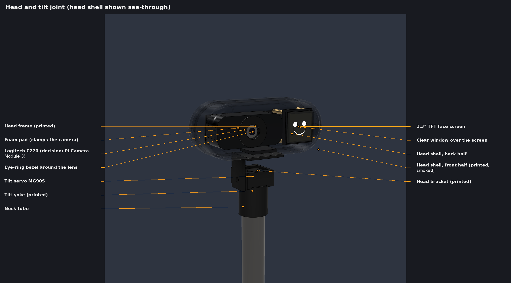 |

**Not modelled yet:** wires, the screws, a fuse, a charging port, and the audio parts the brain plan needs (mic, amplifier, speaker). They come up again in the review.

## 3. How power and data flow

Solid lines are in v1. **Dashed boxes are things I recommend adding.** The signal assignments (which board talks to which) are my proposal; the parts list doesn't decide them yet.

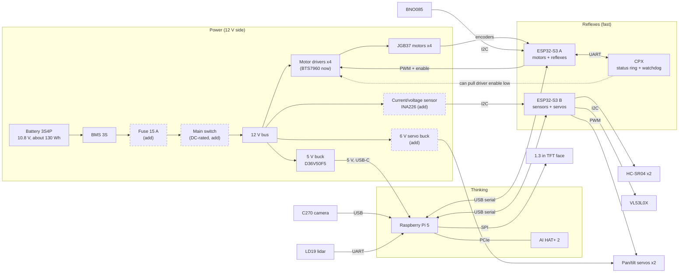

## 4. Honest review

### The short version

v1 does what it set out to do. Every part fits at real size, with no clashes. The battery is low and easy to swap, nothing printed is bigger than a normal printer bed, and it looks like concept K. But it's a **layout**, not yet a **build**:
- The power system is missing safety parts (fuse, a proper switch).
- It shares one 5 V supply between the Pi and the servos, which will cause random reboots.
- It uses motor drivers about 15 times stronger than the motors need, and that one choice drives a lot of the body's size.
- The neck is long enough to make the camera shake.

None of this is hard to fix. Most of it is cheaper and lighter than what's in v1 now.

### What's good

- **Real parts at real sizes, checked.** No clashes between parts, measured clearances, every board has a fixing, and every printed part fits a 256 mm bed. That's the hard part, and it's done.
- **Battery placement.** One flat layer of 12 cells in the middle, as low as it can go. The centre of gravity is 99 mm off the floor on a 5.5 kg robot, and it would take a tilt of about 56° to tip it over. Swapping the battery doesn't need tools.
- **Everything has its place.** Motors next to their drivers, ports facing a service window, and a thought-through cable path through the deck and up the neck.
- **Neck mechanism.** Bearings take the side loads and a collar takes the weight, so the servos only turn things.
- **It reads as the concept:** smoked shell, visible tech, glowing ring, a face with a camera eye and a screen eye.
- **It's parametric.** You can change the body height or neck length and it rebuilds cleanly.

### What's overkill

**1. Four BTS7960 drivers. Yes, this is overkill.** **[Accepted: DRV8874 class for v2]**

The motors need very little:
- A 12 V JGB37-520 typically draws about **0.12 A** with no load and **1 A or less** when working.
- It draws about **2.3 A when fully stalled** ([Voltaat](https://www.voltaat.com/products/12v-high-torque-metal-dc-geared-motor-with-encoder-530-rpm-3-1-kg-cm), [RAM-E-Shop](https://www.ram-e-shop.com/shop/dc-jgb37-12v-set-110rpm-jgb37-520-dc-geared-motor-12vdc-110-rpm-complete-set-with-encoder-9326)). Some versions stall at only about 1.2 A.

The BTS7960 is built for **43 A**. Each board is 50 × 50 × 43 mm and about 66 g, so the four together weigh about **264 g**. Their height (with standoffs) is what puts the upper deck at 80 mm.

How the options compare:

| Driver | Current it handles | Max voltage | Size | Fit for a 2.3 A stall at 12.6 V |
| --- | --- | --- | --- | --- |
| BTS7960 (IBT-2), one per motor | 43 A | about 27 V | 50 × 50 × 43 mm, 66 g | Works, but huge |
| **Pololu DRV8874 carrier, one per motor** | **2.1 A continuous, 4.4 A default limit (6 A chip peak)** | **37 V** | **15 × 18 mm, 0.9 g** | **Good fit**: covers normal driving, limits stalls, and has a current-sense output for the stall reflex ([Pololu](https://www.pololu.com/product/4035)) |
| TB6612FNG, one board for two motors | 1.2 A average, 3.2 A peak (20 ms) per channel | 13.5 V recommended, 15 V absolute max | tiny | **Too tight.** A full 3S pack is 12.6 V, close to its limit, and a stalled motor exceeds its continuous rating ([Toshiba datasheet](https://toshiba.semicon-storage.com/info/TB6612FNG_datasheet_en_20141001.pdf?did=10660&prodName=TB6612FNG)) |

My recommendation is **four DRV8874 carriers** (about $12 each from Pololu), or a dual-channel board rated at least 2.5 A continuous per channel and 16 V+. That saves about 260 g and four big boards, and lets the deck drop by about 10–15 mm. The motors (top at 65.5 mm) then set the deck height, not the drivers.

**2. Two ESP32-S3s.** **[Accepted: start with one]** One ESP32-S3 has enough hardware for v1:
- four hardware pulse counters for the four encoders;
- plenty of PWM outputs;
- I²C for the IMU and ToF;
- spare pins for the ultrasonics.

A second board doubles the firmware, the USB cables and the ways it can go wrong. The plan to split "reflexes" from "sensors" is sensible later. For a first build, I'd start with one and keep the second cradle empty.

**3. CPX behind smoked acrylic.** As a light ring it works. But its touch pads, light sensor and microphone are wasted behind a wall, and it's a large board for 10 LEDs. It earns its place only as the **backup watchdog that can cut the motor drivers**, so wire it for that, or replace it with a €5 NeoPixel ring driven by the ESP32.

**4. The 40 × 40 footprint.** The front half of the upper deck is nearly empty. The v2 plan (30 × 30, stacked levels) is the right correction.

**5. 3S 40A BMS.** Worst case, the whole robot draws about 12 A (four stalled motors plus electronics). A good 20 A BMS is enough, and smaller.

### What should be added (most important first)

1. **[Accepted] A main fuse.** Nothing currently protects the wiring if something shorts, and a 3S4P pack can deliver far more current than any wire in the robot can carry. Put a **15 A blade fuse** right after the BMS, and use 1.5 mm² (16 AWG) wire for the main 12 V run.
2. **[Accepted] A real DC power switch, somewhere you can reach.**
   - The KCD1 rocker is a mains-AC part. Breaking 12 V DC with motors attached makes it arc and wear out.
   - It also sits low on the rear door, which is the hardest place to reach in a hurry.
   - Use a DC-rated switch of 15 A or more (or a removable XT60 "loop key"), on the top or upper back.
3. **[Decided differently] A hardware way to stop the motors.** Adam chose software speed and acceleration limits plus bumpers, with no e-stop (see section 5). Wiring the driver enable lines to a watchdog still costs almost nothing. With the e-stop gone (Adam's call, and that's fine), make sure stopping doesn't depend on software alone. Wire the driver enable lines so the CPX watchdog, or a hardware watchdog on the ESP32, can cut them. Add a simple remote kill later.
4. **[Accepted] A separate supply for the servos.**
   - An MG90S stalls at about **0.75–0.86 A**, and cheap clones can spike higher ([Sky Star datasheet](https://www.tinytronics.nl/product_files/000263_Data%20Sheet%20of%20MG90S%20Analog%20Servo%20Motor.pdf)).
   - Two servos jerking on the same 5 V rail as the Pi 5 will cause brownouts and random reboots.
   - Add a small 5–6 V buck (around 2.5 A) just for the servos.
5. **[Accepted] Make the Pi 5 accept the buck converter's power.**
   - A plain buck can't do USB-PD. The Pi 5 then limits all its USB ports to **600 mA in total**, and the C270, the lidar adapter and two ESP32s are close to that already.
   - The fix is `usb_max_current_enable=1` in `config.txt`, or `PSU_MAX_CURRENT=5000` in the EEPROM. Only do this with a supply and wiring that really hold 5 V at 5 A ([Raspberry Pi docs](https://www.raspberrypi.com/documentation/computers/raspberry-pi.html)).
   - Also **move the buck next to the Pi**. Right now it's at the front, about 250 mm from the Pi, and that's a long way to carry 5 A at 5 V.
6. **[Accepted] Cliff sensors on all four sides.** Mecanum wheels drive sideways and backwards, but there's only one cliff sensor, at the front. Three more VL53L0X boards cost very little and close the gap at the stairs.
7. **[Open] A charging port.** At the moment you charge by pulling the sled out and using a balance charger. Add a charge input through the BMS (a 12.6 V CC/CV charger). The dock will need it anyway.
8. **[Accepted] Battery monitoring.** An INA226 current/voltage sensor gives the "battery time left" model and the low-battery limp mode in the plan something to read.
9. **[Accepted] Audio.** The brain plan uses wake word, speech-to-text and text-to-speech, but there's no microphone or speaker in the design. INMP441 + MAX98357A + a small speaker fit easily in the empty front of the deck.
10. **[Accepted] Level shifting for the HC-SR04s.** Their echo pin outputs 5 V, and ESP32 pins are 3.3 V only. Use a resistor divider, or the 3.3 V-friendly HC-SR04P version.

### What should change

- **[Pending, v2 torso] Neck height.** At 48 cm of 25 mm tube, the head will sway and shake when the robot drives or stops, which blurs the camera. It also blocks about 9° of the lidar's view. The 22 cm option looks more like K and will work better. Pip is handling that decision with Adam; I'd pick the short neck.
- **[Pending] Shell material.**
  - 3 mm acrylic is about 1 kg of the robot's 5.5 kg, and acrylic cracks when hit, around screw holes and at sharp corners.
  - Polycarbonate is much tougher but doesn't laser-cut cleanly; PETG sheet is in between.
  - At the least, keep acrylic away from bumper zones.
  - The 406 mm top also needs a bigger laser than most makerspaces have.
- **Ground clearance and wheels.** 20 mm under the plate and 80 mm mecanum wheels will struggle on rugs and door thresholds. Mecanum wheels with hard rollers also slip on carpet. That's fine for hard floors; know it before you blame the code.
- **[Accepted: Pi Camera Module 3] Head camera.** The C270 is 73 mm wide, and that's what makes the head so wide. A Raspberry Pi Camera Module (about 25 × 24 mm, ribbon cable) would allow a much smaller, nicer head and free a USB port. It's a parts change, so it's Adam's and Pip's call.
- **Wiring.** v1 has cable paths but no harness. In real robots the wiring is often the messiest, least reliable part. Pick connector families early (for example XT30 for power, JST-XH for signals), and add a small power distribution board.

### What should be removed

- The four BTS7960s (replace with DRV8874s, see above).
- The KCD1 rocker (replace with a DC-rated switch).
- **[Pending]** Probably the rear HC-SR04: the lidar already sees behind. Keep the front one, because ultrasound sees glass and lidar doesn't.
- Optionally, the second ESP32 for the first build.

### Risks

- **Random reboots** from servos and the Pi sharing 5 V, and from long 5 V wiring. This is the most likely problem on the first power-up.
- **Wire damage or fire** if anything shorts, because there's no fuse.
- **No easy way to cut power fast.** The switch is low on the back, and there is no e-stop.
- **Camera shake and blur** from the long neck.
- **Falling down stairs** while strafing or reversing, with only one cliff sensor.
- **A cracked acrylic shell** after a bump or a fall.
- **Estimated dimensions:** C270 depth, encoder length, HAT heatsink height, BTS7960 height and LD19 hole positions. Measure them when the parts arrive.
- **Not checked:** the full pan and tilt range of motion (only the rest position was checked for clashes), heat inside the closed shell, and how much room real plugs and cable bends need.

### What I'd do differently in v2

v2 is the 30 × 30 cm, taller, stacked WALL-E torso.

1. **Start with the power diagram, not the shell.** Fuse, switch, 12 V bus, 5 V for compute, separate servo power, current sensing. Then place the parts.
2. **Use small drivers** (DRV8874 class). They free a whole level's worth of height and about 260 g.
3. **Stack by heat and weight.**
   - Bottom: the battery, laid flat, with the drivers.
   - Middle: power distribution and the ESP32.
   - Top: Pi + HAT, with a clear air path up and out, like a chimney.
4. **Design the harness as a part**: connector types, cable lengths, strain relief, and a removable top so you can work inside.
5. **A shorter, stiffer neck** (or a two-joint neck like K's). That keeps the camera steady and gets it out of the lidar's view.
6. **Four cliff sensors, a charge port for the dock, and audio**, all in from the start.
7. **Measure the bought parts first**, then lock the dimensions marked as estimated.
8. **Keep what worked:** real-part modelling, the interference and clearance checks, the slide-out battery, and print-bed-sized parts.

## 5. Speed check: 530 rpm motors with 100 mm wheels

Adam's choice for v2 is 4× JGB37-520, 12 V, **530 rpm** (19:1 gearbox), with **100 mm** mecanum wheels. Speed is a benchmark goal, not for chasing people. The robot will mostly drive slowly.

**For comparison, v1 as modelled.** The 24 mm gearbox is the 56:1–90:1 family, which gives 107–178 rpm depending on the base motor. On 80 mm wheels that's only **0.45–0.75 m/s**: walking pace at best.

**Inputs:**
- **Motor (12 V, 530 rpm, 19:1):**
  - 530 rpm with no load.
  - About 407 rpm at its most efficient working point, where it delivers 2.2 kg·cm at 1 A or less.
  - Stall torque 3.1 kg·cm, stall current about 2.3 A.
  - Sources: [Voltaat](https://www.voltaat.com/products/12v-high-torque-metal-dc-geared-motor-with-encoder-530-rpm-3-1-kg-cm), [Mikroelectron](https://mikroelectron.com/product/me-9371).
- **Battery:** the 3S pack is 12.6 V full, 11.1 V nominal and about 10.5 V nearly empty. Motor speed scales with voltage.
- **Robot:** about 5.5 kg (the v1 mass; v2 will differ a little). Wheel radius 50 mm, one wheel turn = 314 mm.
- **Rolling resistance** of mecanum on a hard floor is estimated at about 5 % of the weight, about 2.7 N.

**Top speed:**

| Condition | Wheel rpm | Speed |
| --- | --- | --- |
| No load, 12 V (the catalogue number) | 530 | 2.8 m/s |
| No load, full battery 12.6 V | about 557 | 2.9 m/s |
| No load, nominal 11.1 V | about 490 | 2.6 m/s |
| **Real driving, nominal battery** (motor model minus rolling resistance and gear losses) | about 380–420 | **about 2.0–2.2 m/s** |
| Real driving, full battery | | about 2.3 m/s |
| Sideways (strafing), estimate | | about 1.4–1.7 m/s (rollers slip more) |

So the real top speed is **about 2 m/s (7 km/h)** on a hard floor: a brisk walk. A jogger at 2.5–3 m/s would pull away. That fits the plan now that speed is only a benchmark. Carpet and rugs will cut it noticeably.

**Torque and acceleration on 5.5 kg:**
- **Pushing force at a standstill** (stall torque at 11.1 V): 4 wheels × 0.28 N·m ÷ 0.05 m ≈ **22 N**.
- **Starting acceleration:** (22 − 2.7) ÷ 5.5 ≈ **3.6 m/s²**. At the motors' rated torque it's about 2.4 m/s².
- **0 to 2 m/s in about 1.4 s.** Force drops as a DC motor speeds up, so it creeps toward its top speed.
- **Wheels won't spin on a hard floor.** Rubber rollers grip at roughly 0.5 g, about 4.9 m/s², which is more than the motors can push.
- **Ramps:** it can climb about **14°** at rated torque.
- **Against 80 mm wheels on the same motor:** 100 mm wheels are 25 % faster, with 20 % less pushing force. Plenty for a 5.5 kg indoor robot.

**Stall current and the DRV8874:**
- One motor stalls at about **2.3 A** at 12 V (about 2.1 A at 11.1 V, about 2.4 A on a full pack). Four stalled at once is about 9–10 A, under the 15 A main fuse.
- Normal driving is **0.3–1 A per motor**.
- The DRV8874 carrier handles **2.1 A continuously** and limits current at **4.4 A** by default (6 A chip peak), with thermal shutdown ([Pololu](https://www.pololu.com/product/4035)).
- **So it covers this motor.** Normal driving is well inside its range, and a stall stays under the current limit. Only a stall lasting many seconds would heat it until it shuts itself off.
- Better still, let the ESP32 read the DRV8874's current-sense pin (about 1.1 V per amp) and cut a motor that has been stalled for more than about 0.5 s. That's a reflex the plan already lists.
- If v2 ever moves to a bigger motor (stall above about 4 A), the DRV8874 is no longer enough.

**Small knock-on changes for v2:**
- The 19:1 gearbox is 22 mm long instead of 24 mm.
- 100 mm mecanum wheels are wider and taller than the 80 mm ones; check the exact width of the wheel you buy before sizing the wheel wells.
- Typical Hall encoders give 11 pulses per motor turn. That's 11 × 19 = 209 per wheel turn, or about 836 with all four edges counted: about **0.4 mm of travel per count** on a 100 mm wheel (estimate), which is fine for odometry.

**Safety plan (Adam's decision: no e-stop):**
- **Software speed and acceleration limits, enforced by the ESP32 as reflexes**, so the Pi or the cloud mind can't override them:
  - Normal indoor mode: about 0.5 m/s and 1 m/s².
  - "Benchmark mode" for the fast runs: switched on deliberately, in a cleared space only.
  - Gentle braking ramps, because a tall v2 torso and a head on a neck will sway when the robot stops hard. A v1-shaped robot only tips at about 14 m/s², but a taller v2 tips sooner, and the camera shakes well before that.
- **Bumpers:** contact switches on all four sides go straight to the ESP32. A press stops the motors at once, before any software layer knows about it.
- **The rest of the reflex set:** 4 cliff sensors, the ultrasonic for glass, the 200 ms no-command stop, stall cut-off from current sensing, the 15 A fuse and a reachable DC-rated main switch.

---
*Pictures are Fusion viewport captures from the backup copy, made by `scripts/diag.py` and `scripts/callouts.py`, and labelled by `scripts/annotate.py` and `scripts/callout_annotate.py`. The current figures come from the linked datasheets and seller listings; check them against the exact motors and servos you buy.*
