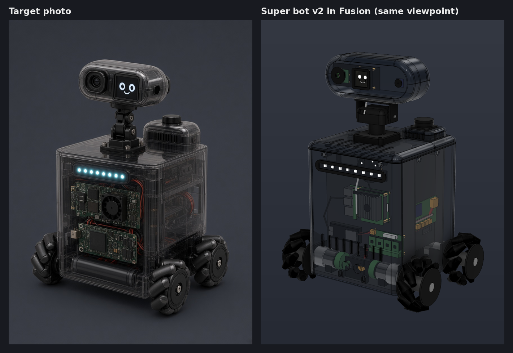
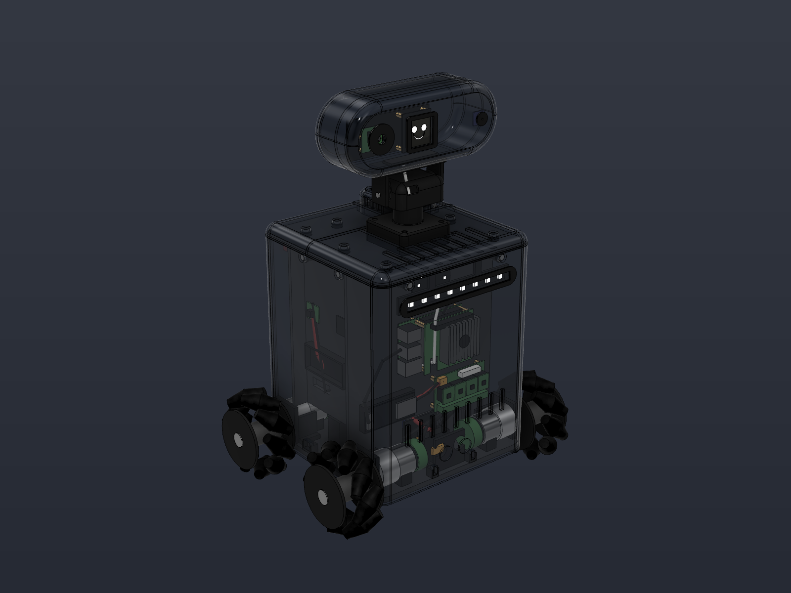
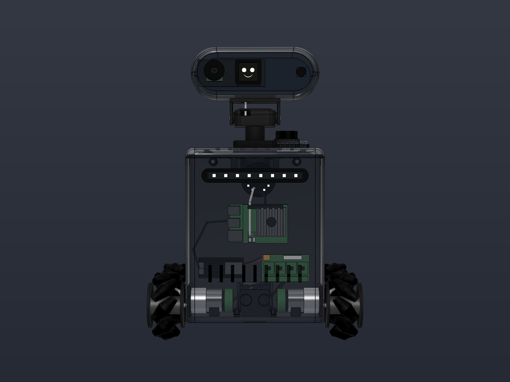
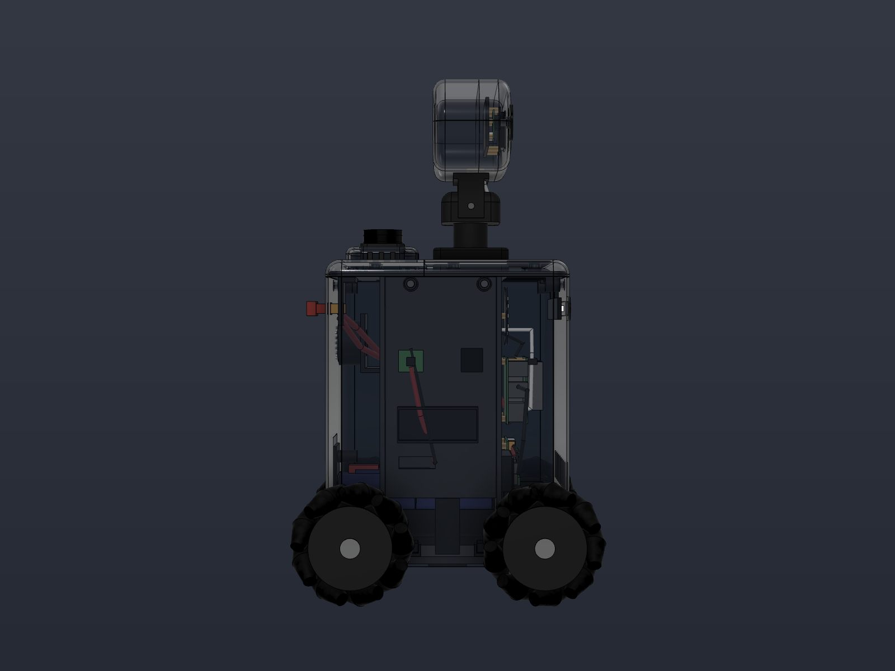
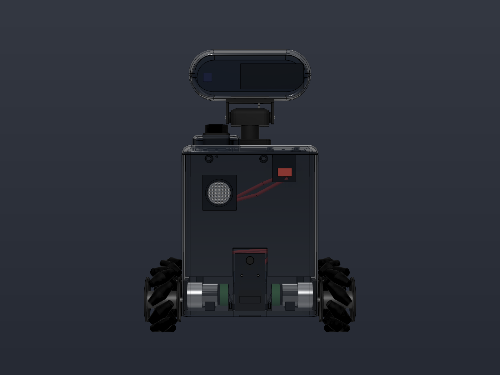
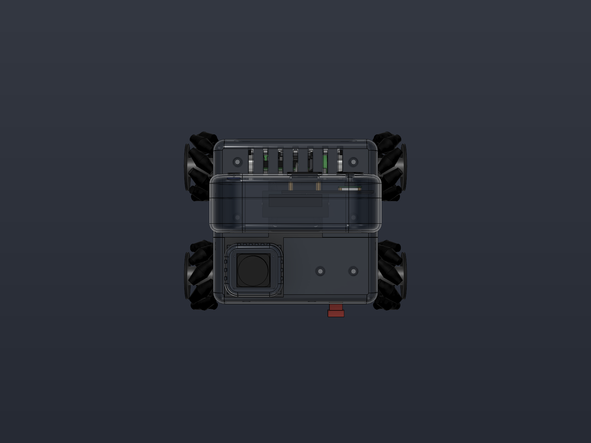
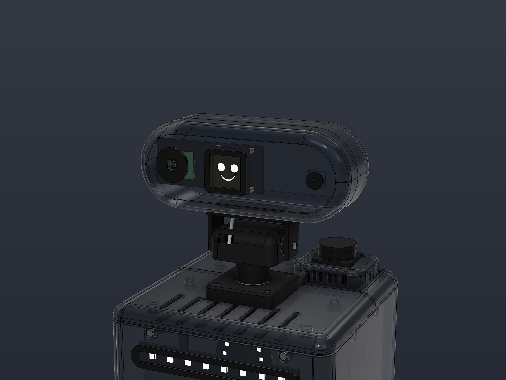
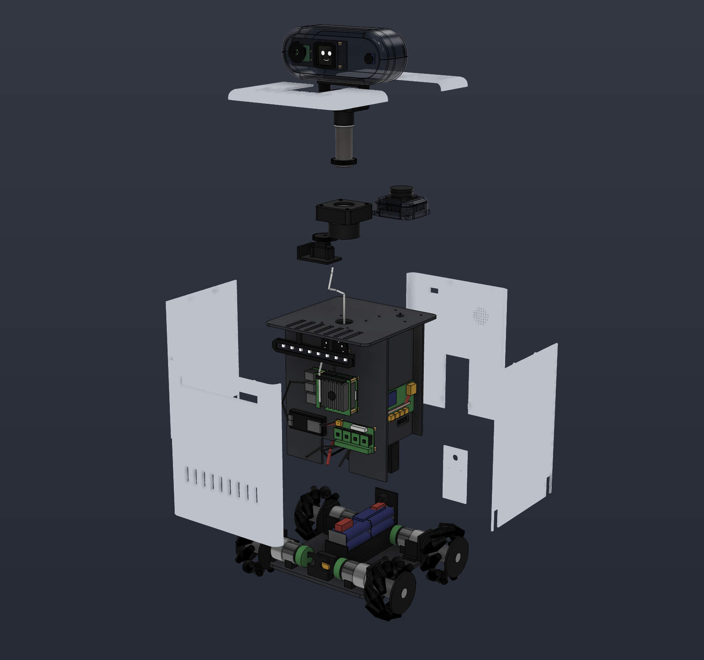
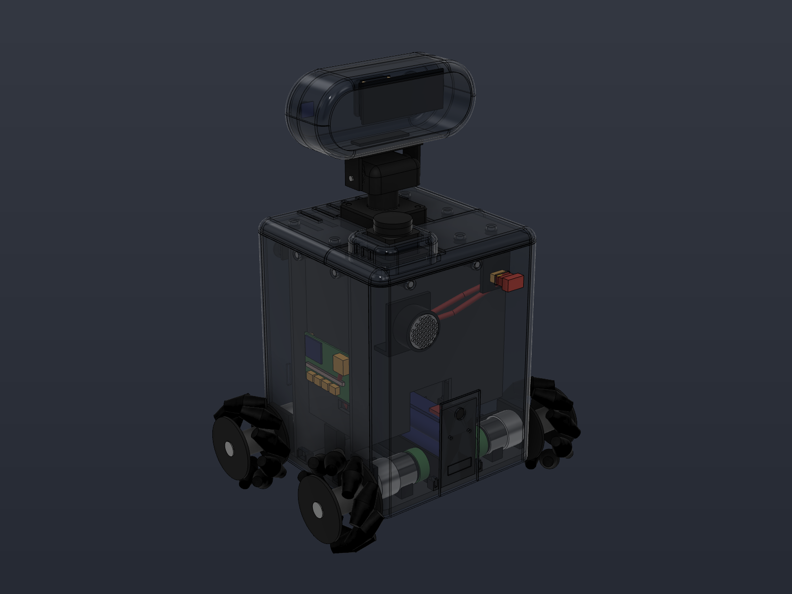

# Super bot v2

The buildable v2 robot, designed in Autodesk Fusion as **"Super bot - v2"** (Adam's *Default Project*). `super-bot-v2.f3d` is an archive copy, `super-bot-v2.step` the whole robot as an assembly. Every part is built by the scripts in `scripts/`, from user parameters, at real datasheet size.

It follows Adam's target photo (`docs/concepts/v2-target-photo.png`): a compact rounded smoked box a bit taller than wide, boards stacked flat behind the front wall, big mecanum wheels sticking out at the corners, a short chunky gimbal with a wide capsule head, a lidar pod at the top rear and an LED bar near the top of the front.

| 3/4 | Front | Side | Rear |
| --- | --- | --- | --- |
|  |  |  |  |

| Top | Head close-up | Exploded | Rear 3/4 |
| --- | --- | --- | --- |
|  |  |  |  |

Close-up callouts with leader lines, one per area, are in [`review/callouts/`](review/callouts): wheel corner, battery, front chimney, back and sides, right cheek, gimbal, head, lidar pod, shell retention.

## Headline numbers

- **Body box:** 200 W x 200 D x 250 H mm (height = 1.25 x width, as in the photo). Rounded: 14 mm vertical corners, 12 mm top edges.
- **Overall:** 306 x 252 mm on the ground (wheels outside the body), **429 mm** to the top of the head.
- **Wheels:** 100 mm, 40 % of the body height. Track 256 mm, wheelbase 152 mm.
- **Mass:** about **5.0 kg** (5026 g). Bought parts use real masses, printed parts Fusion's PETG density (non-shell printed parts at 75 % for infill), ply its density, plus 220 g of wiring.
- **Centre of gravity:** x -1.2, y -1.5, **z 127 mm**.
- **Tip-over:** static tip angle **31 deg** forward/back, **45 deg** sideways. On a flat floor it tips forward only above about **5.9 m/s^2 (0.6 g)** of braking; the motors can push about 3.9 m/s^2, so it can't tip itself on the flat, but keep the ESP32 limits (1 m/s^2 indoors) because the head sways long before that.
- **Interference:** **0** between parts at rest (8 grouped checks covering all 388 bodies), and **0** between the moving head and everything else at 15 pan/tilt poses (pan -90/-45/0/45/90 x tilt -35/0/45). `review/checks-quick.json`, `review/checks-sweep.json`.
- **Print bed:** all printed parts fit a 256 x 256 x 256 mm bed. The biggest are the front and rear walls, 200 x 236 x 14 mm.
- **Timeline:** healthy, 101 user parameters.

## Layout

Coordinates: mm, Z up, +Y front, +X right, ground at Z 0.

**Drive (corners).** Four JGB37-520 12 V 530 rpm (19:1) motors sit inside the body on printed mounts, gearbox faces 7 mm inside the side walls. The shafts pass through U-slots in the side walls to 100 x 50 mm mecanum wheels outside the body, X configuration (seen from above, the top rollers point at the centre, so it can spin and strafe). Chassis plate: 6 mm birch ply, 194 x 194, 30 mm ground clearance.

**Battery (low, central, removable).** 3S4P 18650 (12 cells, about 130 Wh) packed as a 2 (wide) x 3 (high) x 2 (long) block, 38 x 58 x 134 mm, on a printed sled at the bottom centre. It slides **out of the back** between the rear motors (the wheels outside the sides leave no side gap). The battery door is a shell piece screwed to the sled; it carries the **charge jack** (5.5 x 2.1, 5 A, with its own 5 A fuse) on the pack side of the main switch, so charging works with the loop key out. BMS 3S 20 A and the **15 A blade fuse** ride on top of the pack. At the front the sled **blind-mates an XT60** in a bulkhead under the spine.

**Front chimney (what you see through the front).** A vertical 4 mm ply spine 44 mm behind the front wall carries, bottom to top: the motor-driver board (4x Pololu DRV8874 on a perfboard; their sleep line is shared with the CPX watchdog) and the ESP32-S3 in a printed cradle; the Raspberry Pi 5 8 GB + Active Cooler + AI HAT+ 2 standing flat against the spine with the heatsink fins vertical and 14.6 mm of air to the front wall (USB/Ethernet face the right wall with about 45 mm of plug room); the Circuit Playground Express; and the LED bar (8 WS2812B LEDs cut from a 60/m strip, behind a smoked diffuser in a 140 mm slot with a black bezel, driven by the CPX). Air comes in through slots above the front motors and leaves through vents in the top deck and the front top half: a real chimney.

**Behind the spine.** The 5 V 5.5 A Pi buck (Pololu D36V50F5) sits right behind the Pi's USB-C (Pi set to 5 A mode); the BNO085 sits low near the centre. Two ply side cheeks and a rear plate close the frame into a box (no corner rods). Left cheek: power distribution board (XT60 in, 4x XT30 out, 12 V bus bar) with the INA226 20 A module. Right cheek: an empty printed cradle for a second ESP32-S3, the MAX98357A amp and the separate servo 6 V buck (Pololu D36V28F6). Rear plate: 40 mm speaker firing through a rear grille, and the **XT60 loop key** (the main DC switch) on the upper back.

**Top.** Gimbal forward of centre: a 64 mm square printed plinth (4 visible M3) holding the upper 6805 bearing; the lower 6805, the 1:1 36T printed gear pair and the pan MG90S hang under the top deck. A hollow 25 x 1 mm aluminium shaft carries the knuckle and the turret; the head's weight sits on a thrust collar on the upper bearing, so the servo only turns it. The turret holds the tilt MG90S lying down, with the tilt on two 6800 bearings. The head is a 190 x 76 x 64 smoked capsule: Camera Module 3 behind an eye-ring bezel at one end, the 1.3" TFT face beside it, the INMP441 mic behind an "ear" bezel at the other end. The camera ribbon (Pi 5 22-pin, 500 mm) runs from the Pi through a spine slot, down into the bottom of the hollow shaft and up through it into the turret and head.

**Lidar.** LD19 in a rounded vented pod at the rear left, bolted to the top deck. The LD19 sits inside on a shelf so only its cap shows. Its scan plane (z 301) passes between the plinth top (z 290) and the turret bottom (z 312): the head and fork stay at least **6.3 mm** above it at every pan and tilt pose.

**Shell.** 2.4 mm smoked translucent PETG, 7 pieces: front and rear walls (each with both corner rounds), two flat side walls, two top halves (split front/back) and the battery door. 0.4 mm seams. Each wall has two drop-in tabs at the bottom (into printed clips on the plate edge) and two 6 x 3 mm magnet pairs at the top (blocks under the top deck). Each top half has magnets onto the top deck. **To open:** slide the front top half forward off the plinth and the rear one back off the pod, then lift any wall straight up (the side walls clear the wheel shafts through their U-slots). Pull the loop key before taking off the rear wall.

## Power

Path: pack -> BMS -> 15 A blade fuse -> XT60 (sled, blind mate) -> XT60 loop key on the upper back -> PDB with INA226 -> XT30 branches: motor drivers, Pi 5 V buck, servo 6 V buck. Charge jack -> 5 A fuse -> pack side of the key. Connector families: XT60 main, XT30 branches, JST-XH signals, STEMMA QT for the I2C sensors.

| Load | Standing, awake | Driving indoors (0.5 m/s) |
| --- | --- | --- |
| Pi 5 (vision + controller) | 6 W | 6 W |
| AI HAT+ 2 running YOLO | 3 W | 3 W |
| LD19 lidar | 0.9 W | 0.9 W |
| Camera Module 3 | 0.4 W | 0.4 W |
| ESP32-S3 | 0.4 W | 0.4 W |
| TFT, CPX + LED bar (low brightness), BNO085, 4x VL53L0X, mic, amp idle | 1.2 W | 1.2 W |
| 5 V subtotal / 0.9 buck efficiency | **13.2 W** | **13.2 W** |
| Pan/tilt servos (own 6 V buck) | 0.3 W | 1 W |
| 4x JGB37-520 (about 5 W no-load in total, plus rolling, turns, strafing) | none | about 15 W |
| **From the pack** | **about 13.5 W** | **about 29 W** |

Pack: 12 Ah x 10.8 V = 130 Wh nominal, about 110 Wh usable.

- Standing awake: **about 8 h**.
- Driving continuously at indoor speed: **about 3.8 h**.
- Typical mix (20 % driving): about 16.5 W, **about 6.5 h**.
- Benchmark sprints near 2 m/s draw about 45-55 W while they last.

Peak: four stalled motors (4 x 2.4 A) + Pi at full load (about 2.3 A at 12 V) + both servos stalled (about 0.4 A) = about 12.3 A, under the 15 A fuse and the 20 A BMS.

## Speed

4x JGB37-520 12 V 530 rpm (19:1), 100 mm wheels (314 mm per turn), 5.0 kg.

- No-load catalogue: 2.8 m/s. **Real top speed on a hard floor: about 2.0-2.2 m/s**; strafing about 1.4-1.7 m/s.
- Pushing force at a standstill about 22 N, so about **3.9 m/s^2** starting acceleration, 0 to 2 m/s in about 1.4 s.
- ESP32 limits (reflex layer): 0.5 m/s and 1 m/s^2 indoors; "benchmark mode" only on purpose, in a cleared space.

## Clearances (measured or set by parameters)

| Pair | Clearance |
| --- | --- |
| Head + fork to the lidar scan plane, worst pose (pan any, tilt 45) | 6.3 mm |
| Plinth top / turret bottom to the scan plane | 11 mm / 11 mm |
| Head bottom to the turret, any tilt | 2.5 mm minimum (head 28 mm above the tilt axis, turret reach 25.5 mm) |
| AI HAT+ 2 heatsink to the front wall | 14.6 mm (fan and chimney air) |
| Pi USB/Ethernet edge to the right wall | about 58 mm (plug room) |
| Battery sled to the rear motors' encoders, each side | 9.9 mm |
| Front gearbox to the shell corner round | about 1.3 mm (tight; set by `wheel_y` and `corner_r`) |
| Wheel inner face to the side wall | 3 mm |
| Pan shaft gear tips to the spine | about 1 mm (tight) |
| Ground clearance: plate / cliff-sensor pockets | 30 mm / 27 mm |
| Shell seams | 0.4 mm |

## Lidar coverage

The scan plane clears the head at every pan and tilt angle. The only thing in the plane is the 30 mm knuckle between the plinth and the turret: from the lidar it blocks a fixed sector about **19 deg** wide, centred about 33 deg to the right of the robot's forward direction (the bounding-box check in `review/checks-a.json` reports a conservative 25 deg). Mask it in software. A taller pod that lifts the plane above the head would remove it, but it no longer looks like the photo (that's a decision for Adam).

## Parts list

**Bought:** 4x JGB37-520 12 V 530 rpm with Hall encoder; 4x 100 mm mecanum wheel, 6 mm hub (X set: 2 left + 2 right); 12x 18650 3000 mAh+ cells; 3S 20 A BMS; mini blade fuse holder + 15 A fuse; inline 5 A fuse holder; 5.5 x 2.1 panel jack 5 A; XT60 pair (sled) + XT60E-F panel socket + XT60 male (loop key); XT30 pairs; 4x Pololu DRV8874 carrier (#4035); Pololu D36V50F5 (5 V 5.5 A); Pololu D36V28F6 (6 V); INA226 20 A module; Raspberry Pi 5 8 GB (owned) + Active Cooler; Raspberry Pi AI HAT+ 2; Raspberry Pi Camera Module 3 + 500 mm Pi 5 camera cable; ESP32-S3-DevKitC-1 (1 now, room for a 2nd); BNO085 (Adafruit 4754); 4x VL53L0X (Adafruit 3317); 1.3" 240x240 TFT (Adafruit 4313); Circuit Playground Express (owned); 8 LEDs of WS2812B 60/m strip; INMP441; MAX98357A (Adafruit 3006); 40 mm 4 ohm speaker (Adafruit 3968); LDROBOT LD19; 2x MG90S; 2x 6805 bearings; 2x 6800 bearings; 25 mm thrust collar; 25 x 1 mm aluminium tube (about 90 mm); 28x 6 x 3 mm N52 magnets; M2/M2.5/M3 screws and brass standoffs; 16 AWG silicone wire, JST-XH leads, STEMMA QT cables. Optional: HC-SR04P (holder and knock-outs are in place, not fitted).

**Printed (PETG, `stl/`):** shell walls x4, top halves x2, battery door (smoked); head shell front/back, plinth, turret, pod (smoked or black); motor mounts + saddles x4, battery sled + 2 rails, XT60 bulkhead, cliff-sensor pockets x4, HC-SR04P holder, ESP32 cradles x2, LED bar carrier + bezel + diffuser, speaker bracket, loop-key bracket, frame brackets x14, cheek pillars x2, pan servo shelf, lower bearing housing, 36T gears x2, knuckle sleeve, tilt hubs x2, tilt fork, head frame, eye-ring/TFT/mic bezels, panel clips x8, magnet blocks x14. Identical parts share a name with a `-2`, `-3` suffix. 87 files.

**Cut (`dxf/`):** chassis plate (6 mm birch ply), spine, rear plate, 2 side cheeks, top deck (4 mm birch ply, stained dark grey in the renders), TFT window (1 mm clear acrylic). The plate and top deck are about 194 mm, so any hobby laser fits them.

**Placeholders / estimates (measure on arrival):** JGB37 encoder length, BMS size, INA226 and INMP441 hole positions, fuse holder bodies, AI HAT+ 2 heatsink size, the LD19 scan-plane height (27 mm, read off a datasheet figure), wheel mass (300 g used; listings say 200-400 g).

## Mass by component

| Component | Mass (g) | Centre of mass x, y, z (mm) |
| --- | --- | --- |
| Shell (printed smoked PETG) | 829 | 1, -0, 170 |
| Battery 3S4P 18650  | 602 | 0, -27, 68 |
| Drive FR | 470 | 106, 76, 52 |
| Drive FL | 470 | -106, 76, 52 |
| Drive RR | 470 | 106, -76, 52 |
| Drive RL | 470 | -106, -76, 52 |
| Frame (4 mm ply) | 326 | 0, -2, 183 |
| Head pan rotor | 320 | 2, 21, 365 |
| Head joint fixed (plinth, pan servo, gears) | 205 | 8, 20, 261 |
| Chassis plate | 116 | 0, 0, 33 |
| Raspberry Pi 5 8GB  | 71 | -4, 57, 168 |
| Battery sled (printed) | 68 | -0, -19, 51 |
| Lidar pod (printed) | 53 | -50, -58, 277 |
| Lidar LDROBOT LD19 | 47 | -50, -58, 290 |
| Raspberry Pi AI HAT | 45 | -21, 73, 172 |
| Audio MAX98357A  | 42 | -43, -80, 206 |
| Power distribution board  | 40 | -87, -6, 150 |
| Main power XT60 loop key | 33 | 50, -100, 240 |
| Circuit Playground Express  | 27 | -1, 83, 238 |
| Motor driver board 4x DRV8874 | 25 | -45, 57, 100 |
| ESP32-S3-DevKitC-1 A | 18 | 49, 50, 102 |
| Power connectors | 16 | 0, 12, 67 |
| Cliff sensors 4x VL53L0X | 15 | 0, 0, 29 |
| ESP32-S3-DevKitC-1 B spare | 8 | 83, -8, 143 |
| Pi 5 V 5.5 A buck (Pololu D36V50F5) | 7 | -26, 33, 154 |
| Front ultrasonic spot (optional HC-SR04P) | 7 | -0, 87, 49 |

## Parameters

Change them in Fusion under Modify -> Change Parameters, or edit the stage scripts. Lengths in mm.

| Name | Expression | Value | Meaning |
| --- | --- | --- | --- |
| `body_w` | `200 mm` | 200.00 | Body box width X (shell outside) |
| `body_d` | `200 mm` | 200.00 | Body box depth Y |
| `body_top` | `body_z0 + body_h` | 278.00 | Body box top Z (T) |
| `pwall` | `2.4 mm` | 2.40 | Printed shell wall (6 perimeters at 0.4) |
| `corner_r` | `14 mm` | 14.00 | Vertical corner radius of the body |
| `top_r` | `12 mm` | 12.00 | Radius of the rounded top edges |
| `shell_x` | `body_w / 2` | 100.00 | Body outer half-width |
| `shell_y` | `body_d / 2` | 100.00 | Body outer half-depth |
| `plate_z` | `30 mm` | 30.00 | Ground clearance under the chassis plate |
| `plate_t` | `6 mm` | 6.00 | Chassis plate thickness (6 mm birch ply) |
| `plate_top` | `plate_z + plate_t` | 36.00 | Top of the chassis plate |
| `plate_w` | `body_w - 2 * pwall - 1 mm` | 194.20 | Chassis plate X |
| `plate_d` | `body_d - 2 * pwall - 1 mm` | 194.20 | Chassis plate Y |
| `wheel_d` | `100 mm` | 100.00 | Mecanum wheel OD (SRC) |
| `wheel_w` | `50 mm` | 50.00 | Mecanum wheel width (SRC Studica/Nexus 100 mm) |
| `wheel_y` | `shell_y - pwall - gb_d / 2 - 3 mm` | 76.10 | Wheel centre /Y/ (half wheelbase); motors just inside the front/rear walls |
| `wheel_xc` | `shell_x + wheel_gap + wheel_w / 2` | 128.00 | Wheel centre /X/ (half track) |
| `mount_wall` | `5 mm` | 5.00 | Printed motor mount wall |
| `gb_face` | `shell_x - pwall - 0.5 mm - mount_wall` | 92.10 | Gearbox face /X/ |
| `axle_z` | `wheel_d / 2` | 50.00 | Wheel axle height |
| `shaft_off` | `7 mm` | 7.00 | Output shaft offset from the motor axis (SRC drawing) |
| `motor_z` | `axle_z + shaft_off` | 57.00 | Motor axis height (shaft below the axis) |
| `gb_d` | `37 mm` | 37.00 | JGB37 gearbox diameter (SRC) |
| `gb_len` | `22 mm` | 22.00 | JGB37 gearbox length, 19:1 (SRC) |
| `can_d` | `33 mm` | 33.00 | JGB37 motor can diameter (SRC) |
| `can_len` | `22.7 mm` | 22.70 | JGB37 motor can length (SRC) |
| `cap_len` | `3.5 mm` | 3.50 | JGB37 rear cap (SRC) |
| `enc_len` | `12 mm` | 12.00 | Hall encoder length (EST, measure) |
| `collar_len` | `6 mm` | 6.00 | Gearbox pilot boss (SRC 12 x 6) |
| `shaft_len` | `15.5 mm` | 15.50 | 6 mm D-shaft length (SRC) |
| `cell_d` | `18.6 mm` | 18.60 | 18650 cell diameter |
| `cell_l` | `65.2 mm` | 65.20 | 18650 cell length (flat top, unprotected) |
| `pack_x` | `2 * cell_d + 1 mm` | 38.20 | Pack width X (2 cells) |
| `pack_y` | `2 * cell_l + 4 mm` | 134.40 | Pack length Y (2 cells end to end + nickel) |
| `sled_wall` | `2.4 mm` | 2.40 | Battery sled wall |
| `tof_r` | `80 mm` | 80.00 | Cliff sensor distance from the centre (under the plate) |
| `top_deck_z` | `body_top - 14 mm` | 264.00 | Top deck underside |
| `top_deck_top` | `top_deck_z + ply_t` | 268.00 | Top deck top |
| `spine_y` | `44 mm` | 44.00 | Spine front face Y |
| `pan_y` | `20 mm` | 20.00 | Head pan axis Y (forward of centre; the pan gear clears the spine) |
| `lidar_y` | `-58 mm` | -58.00 | Lidar centre Y (rear) |
| `pan_servo_x` | `36 mm` | 36.00 | Pan servo shaft X (1:1 gear pair, 36 mm centre distance) |
| `pi_xc` | `-5 mm` | -5.00 | Pi 5 PCB centre X (USB/Ethernet edge faces +X, ~40 mm plug room) |
| `pi_z0` | `plate_top + 104 mm` | 140.00 | Pi 5 PCB bottom (HDMI/USB-C) edge Z |
| `pi_so` | `6 mm` | 6.00 | Pi standoffs off the spine |
| `pi_y0` | `spine_y + pi_so` | 50.00 | Pi PCB back face Y |
| `hat_so` | `16 mm` | 16.00 | AI HAT+ 2 spacer height (SRC) |
| `cpx_z` | `pi_z0 + 92 mm` | 232.00 | CPX centre Z |
| `shaft_od` | `25 mm` | 25.00 | Pan shaft: 25 x 1 mm aluminium tube (fits 6805 bearings) |
| `seam_gap` | `0.4 mm` | 0.40 | Gap between shell pieces |
| `pod_w` | `70 mm` | 70.00 | Lidar pod width X |
| `pod_d` | `64 mm` | 64.00 | Lidar pod depth Y |
| `mag_d` | `6 mm` | 6.00 | Magnet diameter (6 x 3 mm N52 disc) |
| `mag_t` | `3 mm` | 3.00 | Magnet thickness |
| `scan_h` | `27 mm` | 27.00 | LD19 scan plane above its mounting ears (EST from the datasheet figure) |
| `plinth_h` | `12 mm` | 12.00 | Plinth height above the body top |
| `scan_z` | `body_top + plinth_h + knuckle_h / 2` | 301.00 | Lidar scan plane Z |
| `turret_z` | `body_top + plinth_h + knuckle_h` | 312.00 | Turret bottom Z |
| `tilt_z` | `turret_z + 13 mm` | 325.00 | Tilt axis Z |
| `turret_hw` | `30 mm` | 30.00 | Turret half-width X |
| `turret_hd` | `25 mm` | 25.00 | Turret half-depth Y |
| `head_w` | `190 mm` | 190.00 | Head width (photo match; the original brief asked for smaller) |
| `head_h` | `76 mm` | 76.00 | Head height |
| `head_d` | `64 mm` | 64.00 | Head depth |
| `head_z0` | `tilt_z + 28 mm` | 353.00 | Head bottom Z (clears the turret at any tilt) |
| `head_zc` | `head_z0 + head_h / 2` | 391.00 | Head centre Z |
| `gear_z` | `top_deck_z - 32 mm` | 232.00 | Pan gear pair bottom Z (under the top deck) |
| `shaft_z0` | `gear_z - 4 mm` | 228.00 | Pan shaft bottom Z |
| `cam_x` | `60 mm` | 60.00 | Camera Module 3 centre X |
| `tft_x` | `10 mm` | 10.00 | TFT centre X |
| `body_h` | `1.25 * body_w` | 250.00 | Body box height (1.25 x width, as in the target photo) |
| `body_z0` | `28 mm` | 28.00 | Body box bottom Z |
| `wheel_gap` | `3 mm` | 3.00 | Body side to wheel inner face |
| `pack_z` | `3 * cell_d + 2 mm` | 57.80 | Pack height Z (3 cells) |
| `sled_y0` | `-( shell_y - pwall )` | -97.60 | Sled rear face (the door screws on here) |
| `pack_y0` | `sled_y0 + sled_wall + 0.5 mm` | -94.70 | Pack rear end Y |
| `pack_y1` | `pack_y0 + pack_y` | 39.70 | Pack front end Y |
| `sled_y1` | `pack_y1 + sled_wall + 0.3 mm` | 42.40 | Sled front face Y (XT60 male sticks out here) |
| `sled_hw` | `pack_x / 2 + sled_wall + 0.5 mm` | 22.00 | Sled half-width |
| `tun_hw` | `sled_hw + 4.5 mm` | 26.50 | Battery tunnel half-width (notches in the spine and rear plate) |
| `ply_t` | `4 mm` | 4.00 | Frame ply thickness (4 mm birch ply) |
| `rear_y` | `-51 mm` | -51.00 | Rear plate front face Y |
| `cheek_x` | `76 mm` | 76.00 | Side cheek inner face /X/ |
| `in_x` | `shell_x - pwall - 1 mm` | 96.60 | Frame half-width (inside the shell) |
| `notch_z` | `plate_top + 44 mm` | 80.00 | Spine notch top (XT60 + sled front pass under) |
| `rnotch_z` | `body_z0 + 96 mm` | 124.00 | Rear plate notch top (pack + BMS + fuse pass under) |
| `wall_top` | `body_top - top_r - 2 mm` | 264.00 | Seam between the walls and the top halves |
| `wall_seam_y` | `shell_y - corner_r` | 86.00 | Seam between the front/rear walls and the side walls |
| `door_hw` | `tun_hw - 2 mm` | 24.50 | Battery door half-width |
| `door_top` | `body_z0 + 100 mm` | 128.00 | Battery door top |
| `plinth_s` | `64 mm` | 64.00 | Head plinth size (square) |
| `bar_z` | `body_top - 40 mm` | 238.00 | LED bar centre Z |
| `bar_w` | `140 mm` | 140.00 | LED bar slot length |
| `drv_z` | `plate_top + 46 mm` | 82.00 | Driver board bottom Z (above the front motors) |
| `knuckle_h` | `22 mm` | 22.00 | Knuckle between plinth and turret (the lidar plane passes here) |
| `mic_x` | `-68 mm` | -68.00 | Mic ear centre X |
| `ld_z` | `scan_z - scan_h` | 274.00 | LD19 ear underside Z |
| `pod_top` | `scan_z - 8 mm` | 293.00 | Pod rim Z (5 mm under the LD19 window band) |
| `lidar_x` | `-50 mm` | -50.00 | Lidar centre X (rear left, as in the target photo) |
| `top_seam_y` | `( pan_y - plinth_s / 2 + lidar_y + pod_d / 2 ) / 2` | -19.00 | Seam between the front and rear top halves |
| `frame_z1` | `plate_top + 46 mm` | 82.00 | Bottom of the cheeks and rear plate (clear of the motor mounts) |

## Open issues (honest)

1. **Head size vs the brief.** The first brief asked for a head "much smaller than v1's" (136 x 56 x 50). Matching the photo made it 190 x 76 x 64. `head_w`, `head_h` and `head_d` are the knobs. Decision for Adam.
2. **Lidar blind sector** of about 19 deg from the knuckle (see above). Masking works; the only full fix is a taller pod, which changes the look.
3. **Pod height.** The photo's pod is taller. Here the pod rim must stay under the LD19's window, which must stay under the turret, so the pod is about 15 mm tall plus the LD19 cap.
4. **Footprint.** The body is 200 x 200, but with the wheels outside, the robot needs 306 x 252 on the floor, bigger than the original "about 30 x 30" body idea.
5. **Head flop.** The head's centre of mass is about 66 mm above the tilt axis, so it will nod when the servos are unpowered and sway when braking. A friction washer on the tilt hub, or keeping the tilt servo powered, solves it.
6. **Camera ribbon.** It twists inside the hollow shaft for pan (about 80 mm of free twist length for +/-90 deg) and folds hard where it leaves the shaft under the tilt servo (3.9 mm of room). Test-fit the real 500 mm cable before printing the turret.
7. **Blind-mate XT60.** It needs a firm push (roughly 30-40 N) and good alignment from the sled rails. If it fights, swap to a short pigtail with slack.
8. **Cliff sensors.** The VL53L0X pockets sit 27 mm above the floor, close to the sensor's minimum range. If readings are noisy, sink them 5 mm more into the plate.
9. **Tight spots:** front gearbox to the corner round about 1.3 mm, pan gear to the spine about 1 mm, servo tab to the turret wall under 1 mm. All are clear in the model; check them on the printed parts.
10. **Gears** are modelled as simplified trapezoid teeth. Print real involute 36T m1 gears from a gear generator.
11. **Thermals** are designed (a vertical chimney, vertical fins, a 14.6 mm gap), not simulated. Log temperatures on the first long run.
12. **Frame stiffness.** The cheeks and rear plate start above the motor mounts and stand on two printed pillars; the spine stands on the plate. Check for wobble with the head on top; add a printed gusset if needed.
13. **Bumpers** (part of Adam's safety plan) are not modelled yet. The walls could float on microswitches later.
14. **LED bar** (8 WS2812B on a strip) is a new part, added because the photo has the bar; the CPX drives it.
15. **Wiring** is modelled as paths (pipes) for the main runs, not every wire.
16. **Renders** are Fusion viewport captures; the smoked PETG renders darker than the real material and the photo.

## Files

- `super-bot-v2.f3d`, `super-bot-v2.step`: the design.
- `stl/`: printed parts. `dxf/`: cut parts.
- `renders/`: viewport images (`v2-photo*.png` is the photo-matching view). `review/`: side-by-side with the photo, callouts, check results (`checks-a.json` mass/bed/scan plane, `checks-quick.json` interference, `checks-sweep.json` pan/tilt sweep, `params.json`).
- `scripts/`: the Fusion API scripts, run through the Fusion MCP. `loader.py` fetches `v2lib.py` plus one stage from the VPS file bridge, runs it, uploads the log and saves the document. Stages: `s1_drive`, `s2_battery`, `s3_frame`, `s4_electronics`, `s5_shell`, `s6_head`, `s7_lidar`, `s8_wiring`; then `looks.py`, `checks.py` (`quick()` per stage, `main()` for mass/bed/sweep), `shots.py`, `export.py`. `sidebyside.py`, `compose_bg.py` and `callout_annotate.py` run on the VPS. `old-frame-build/` holds the scrapped first layout.
