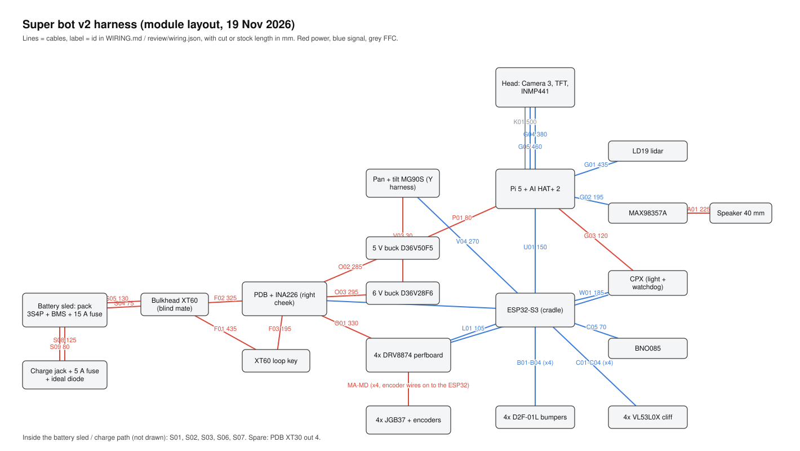
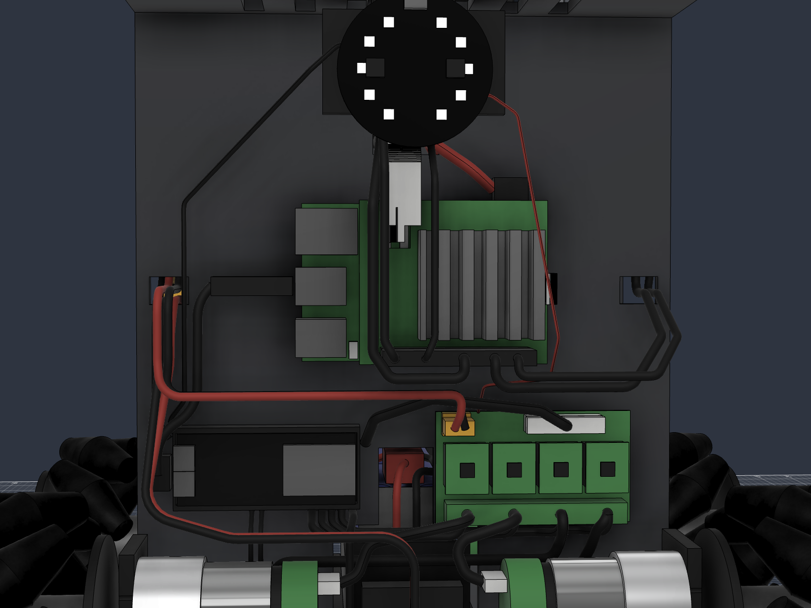
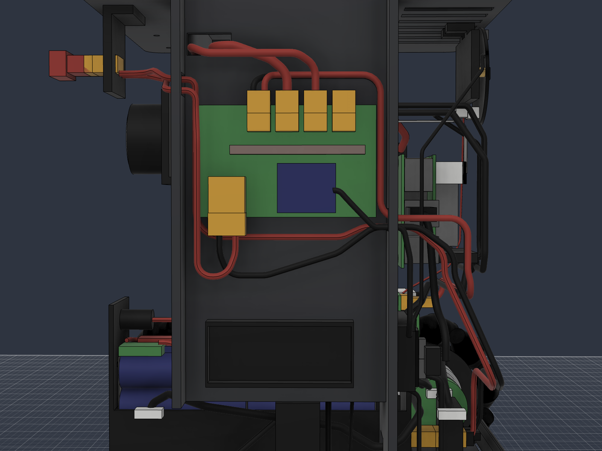
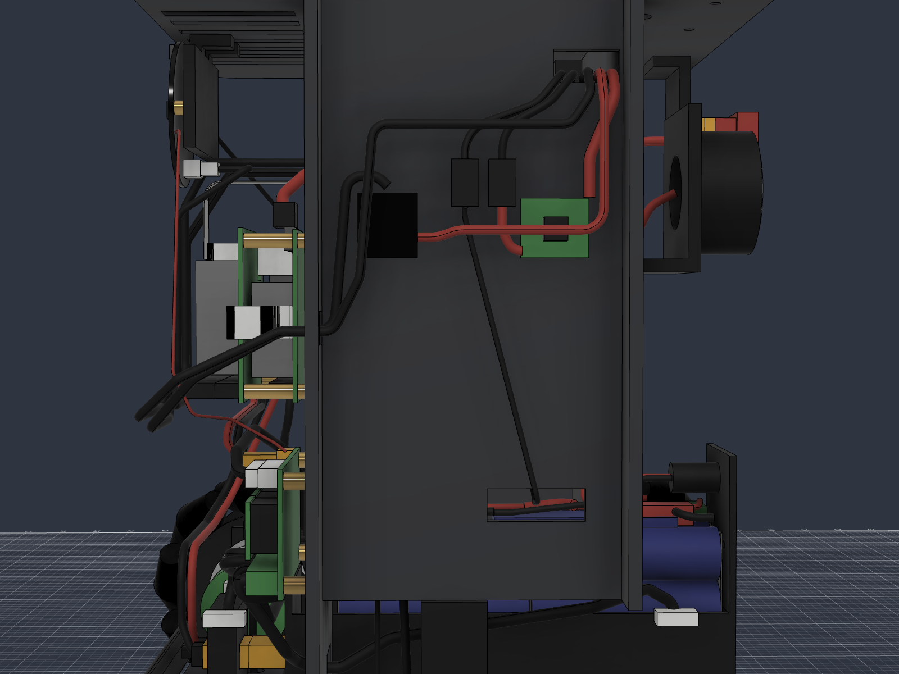
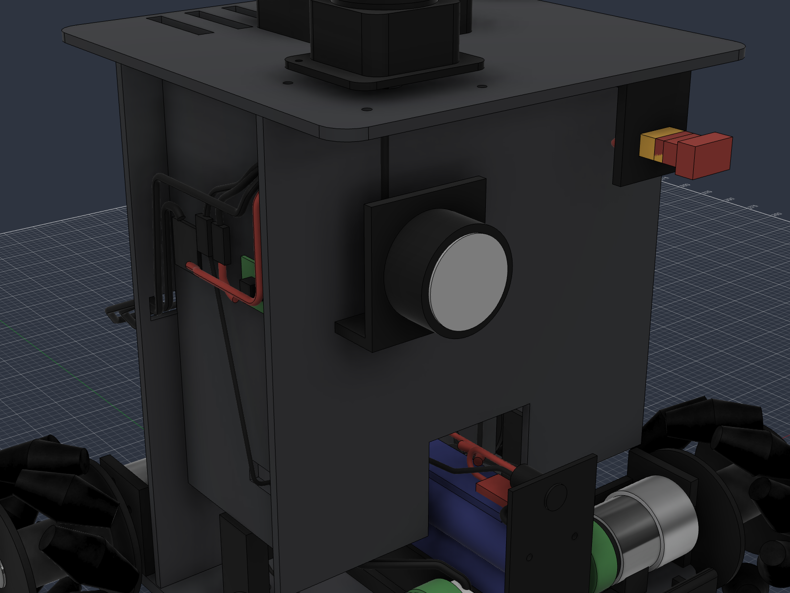
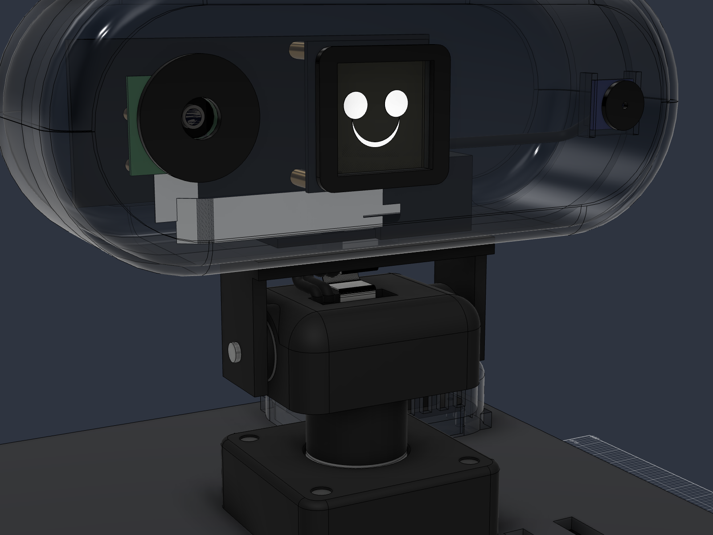

# Super bot v2: wiring harness

Every cable in the v2 robot, modelled in Fusion (doc "Super bot - v2"): component **Wiring harness** (fixed), plus **Wiring harness (tilt)** inside the head, which tilts with it. 19 Nov 2026, module layout (the custom main board is parked; see [docs/decisions.md](../../docs/decisions.md)). Generated from [`scripts/w_routes.py`](scripts/w_routes.py) by [`scripts/w_wiringmd.py`](scripts/w_wiringmd.py); the same data is in [`review/wiring.json`](review/wiring.json) for the BOM thread.

| Front | Right | Left |
| --- | --- | --- |
|  |  |  |

| Rear 3/4 | Head and gimbal |
| --- | --- |
|  |  |

## Model changes made for the wiring (19 Nov 2026)

- Nov 19, 2026: optional HC-SR04P front sonar dropped to make room for the sled XT60 nose; front covered by lidar + bumpers + cliff sensors; J415 spare (on the parked main board).
- Battery sled: 14 mm nose (`sled_nose`) carrying the blind-mate XT60 male; bulkhead + female moved 14 mm forward. Before, the XT60 cups sat 0.7 mm from the pack.
- Raspberry Pi 5 stand-in fixed to pose B: it was a mirror image of a real Pi 5. Checked against the official Pi 5 mechanical drawing (components to the front wall, USB/Ethernet to the right wall, GPIO + AI HAT+ 2 along the bottom edge, USB-C top-left). PCIe FFC position corrected, fan header added; all Pi cables are routed for this pose.
- Back to off-the-shelf modules (no main board); PDB + INA226 moved to the right cheek, amp + 6 V buck to the left, spare ESP32 cradle lowered, 5 V buck behind the Pi USB-C.
- Spine: wire relief over the battery-tunnel notch (x +-10 to z 108) and two low harness slots (x +-48). Head: one 24 x 9 mm cable slot over the pan shaft through turret top, crossbar, head bottom and head-frame foot. CPX bracket bottom raised 6 mm. Placeholders trimmed so real parts fit: AI HAT+ 2 heatsink 42 x 37 (clears the GPIO housing), Active Cooler box clear of the MIPI connectors.

## How it is routed

- **Main feed (16 AWG silicone):** pack -> BMS -> 15 A blade fuse -> sled XT60 male (blind mate, in the sled's 14 mm nose) -> bulkhead XT60 female. From the bulkhead the pair runs up the front power lane 4.6 mm behind the front wall, up the right column, through the right spine slot and along the right side channel. + goes out through the rear-plate loop slot to the XT60 loop key (pin A) and back from pin B to the PDB XT60 on the right cheek; - goes straight to the PDB. Charging (jack -> 5 A fuse -> ideal diode -> pack, on the sled) bypasses the key.
- **12 V outputs:** PDB XT30 1 -> DRV8874 perfboard (back through the right spine slot, right column, over the ESP32); XT30 2 -> 5 V buck on the spine back and XT30 3 -> 6 V servo buck on the left cheek, both through the right upper cheek slot and under the top deck. XT30 4 is spare.
- **Pi 5 (pose B: GPIO along the bottom, USB-C top-left):** 5 V from the D36V50F5 through the spine centre slot into a right-angle USB-C plug (Pi in 5 A mode, `usb_max_current_enable=1`). ESP32 on the Pi's USB 3 port (bought 15 cm USB-A to right-angle USB-C). Everything else from one 2x20 Dupont housing on the AI HAT+ 2 pass-through header: lidar (UART0 RX), I2S amp + mic (BCLK/LRCLK spliced), TFT (SPI0), CPX power.
- **ESP32-S3 carrier:** the DevKit sits pins-down in its printed cradle on two 1x22 female header rows; wires are soldered to the header tails. Three exits: the cradle back through the spine slot behind it (rear motor encoders, rear bumpers, side/rear cliff sensors, BNO085, servo signals), the bottom edge (front motor encoders, front bumpers, front cliff), the right end (INA226, CPX heartbeat, USB).
- **Head:** camera FFC (Pi CAM/DISP0), TFT bundle and mic bundle go up the spine back, through the centre slot, into the bottom of the hollow pan shaft, up the shaft (tied just below it), past the lying tilt servo, out of the turret top through one 24 x 9 mm slot, across the tilt joint in a rolling U-loop, and up into the head. TFT and mic are soldered at the head end. The tilt servo lead runs down the same shaft.
- **Bend rule:** >= 4x the conductor OD where static (silicone), >= 10x where a span flexes. Tight spots are listed per cable (min bend / x OD): mostly the first few mm at a terminal (Dupont exits 4 mm from the front wall, sled solder joints), which is normal with heatshrink strain relief.
- **Cut length** = routed centreline + 12 mm (strip/crimp/solder at both ends), rounded up to 5 mm. Bought cables give the stock length; where stock is longer than the route, the slack is stowed as noted.

## Cable schedule

| Id | Cable | From | To | Wire | Cut / stock (mm) | End A | End B | Route | Min bend (mm, x OD) |
| --- | --- | --- | --- | --- | --- | --- | --- | --- | --- |
| S01 | pack B- to BMS B- | pack B- terminal (rear top) | BMS B- pad | 1 x 16 AWG | 30 | solder (pack B- tab) | solder (BMS B- pad) | - | 4.9 (1.7x) |
| S02 | BMS balance lead | BMS balance header (4) | cell group taps 0 / 1 / 2 / 3 | 4 x 22 AWG | 35 | JST-XH 4 housing + 4 XH crimps (BMS balance) | solder to nickel taps | - | 6.4 (4.0x) |
| S03 | B+ to 15 A fuse in | pack B+ terminal (front top) | 15 A fuse holder in-lead | 1 x 16 AWG | 60 | solder (pack B+ tab) | solder/butt splice to fuse-holder lead | - | 4.0 (1.4x) |
| S04 | 15 A fuse out to sled XT60 male + | 15 A fuse holder out-lead | XT60 male (sled) + | 1 x 16 AWG | 75 | butt splice to fuse-holder lead | XT60 male (sled), solder | - | 5.1 (1.7x) |
| S05 | BMS P- to sled XT60 male - | BMS P- pad | XT60 male (sled) - | 1 x 16 AWG | 130 | solder (BMS P-) | XT60 male (sled), solder | - | 5.1 (1.7x) |
| S06 | charge jack + to 5 A fuse in | DC jack 5.5x2.1 centre (+) | 5 A inline fuse in | 1 x 18 AWG | 65 | solder (DC jack tip) | butt splice to inline 5 A fuse lead | - | 5.4 (2.3x) |
| S07 | 5 A fuse out to ideal diode IN | 5 A inline fuse out | ideal-diode module IN | 1 x 18 AWG | 25 | butt splice to fuse lead | solder (ideal-diode IN) | - | 3.5 (1.5x) |
| S08 | ideal diode OUT to pack B+ | ideal-diode module OUT | pack B+ terminal | 1 x 18 AWG | 125 | solder (ideal-diode OUT) | solder (pack B+ tab) | - | 9.2 (4.0x) |
| S09 | charge jack - to BMS P- | DC jack sleeve (-) | BMS P- pad | 1 x 18 AWG | 80 | solder (DC jack sleeve) | solder (BMS P-) | - | 9.2 (4.0x) |
| F01 | main feed + : bulkhead XT60 to loop key A | bulkhead XT60 female + (sled blind mate) | loop key XT60E-F socket pin A | 1 x 16 AWG | 435 | XT60 female (bulkhead), solder | XT60E-F panel socket, solder | up the front power lane, right column, right spine slot, behind the PDB (cheek gap), rear-plate loop slot | 3.5 (1.2x) |
| F02 | main feed - : bulkhead XT60 to PDB XT60 - | bulkhead XT60 female - | PDB XT60H-M plug - | 1 x 16 AWG | 325 | XT60 female (bulkhead), solder | XT60H male plug (PDB), solder | with F01 to the right spine slot, under the PDB, up into the PDB XT60 from below | 6.0 (2.1x) |
| F03 | loop key B to PDB XT60 + | loop key XT60E-F socket pin B | PDB XT60H-M plug + | 1 x 16 AWG | 195 | XT60E-F panel socket, solder | XT60H male plug (PDB), solder | back through the loop slot, down the side channel outboard of the PDB, into the PDB XT60 from below | 4.4 (1.5x) |
| O01 | PDB out 1 -> DRV8874 perfboard 12 V in | PDB XT30 out 1 | DRV perfboard XT30 in | 2 x 16 AWG | 330 | XT30 female plug (PDB out 1), solder | XT30 female plug (DRV perfboard), solder | up over the PDB, forward behind it, right spine slot (upper row), right column, across above the ESP32 |  |
| O02 | PDB out 2 -> Pi 5 V buck VIN | PDB XT30 out 2 | D36V50F5 VIN / GND | 2 x 18 AWG | 285 | XT30 female plug (PDB out 2), solder | solder (D36V50F5 VIN/GND) | right upper cheek slot, across the bay behind the bearing housing, forward beside it, down the spine back | 8.4 (3.6x) |
| O03 | PDB out 3 -> servo 6 V buck VIN | PDB XT30 out 3 | D36V28F6 VIN / GND | 2 x 20 AWG | 295 | XT30 female plug (PDB out 3), solder | solder (D36V28F6 VIN/GND) | right upper cheek slot, across the bay, left upper cheek slot, down the left side channel | 7.6 (4.0x) |
| P01 | Pi 5 V: buck VOUT -> Pi USB-C | D36V50F5 VOUT / GND | Pi 5 USB-C (right-angle plug, 5 A mode) | 2 x 18 AWG | 80 | solder (D36V50F5 VOUT/GND) | DIY right-angle USB-C plug, 5 A, solder type | up the spine back, centre slot, down to the plug; set usb_max_current_enable=1 on the Pi | 6.7 (2.9x) |
| U01 | USB 2.0 data + 5 V: Pi USB 3 -> ESP32-S3 USB | Pi 5 USB-A (USB 3 stack, lower) | ESP32-S3-DevKitC-1 USB-C (native USB) | 4 x 28 AWG | stock 150 (route 71) | bought cable: USB-A plug | bought cable: right-angle USB-C plug | right column (inboard of the power column) | 13.8 (4.0x) |
| G01 | lidar: Pi GPIO -> LD19 | Pi GPIO pins 4 / 6 / 10 (+ GND jumper to LD19 PWM) | LD19 ZH1.5 socket (1 Tx, 2 PWM, 3 GND, 4 P5V) | 4 x 26 AWG | 435 | Dupont 2.54 female crimp in the 2x20 housing x3 (+ GND bridge) | JST ZH1.5 4 housing + 4 ZH crimps | down the front loom, left column, left spine slot, left channel, left upper cheek slot, rear-plate speaker slot (beside A01), up behind the rear plate through the deck hole under the LD19 | 2.9 (2.4x) |
| G02 | I2S out: Pi GPIO -> MAX98357A | Pi GPIO pins 2 / 14 / 12 / 35 / 40 | MAX98357A Vin / GND / BCLK / LRC / DIN (header, soldered) | 5 x 24/28 AWG | 195 | Dupont 2.54 female crimp in the 2x20 housing x5 | solder (MAX98357A header pads) | front loom, left column, left spine slot, left channel | 3.0 (2.1x) |
| G03 | CPX power: Pi GPIO 5 V -> CPX battery JST | Pi GPIO pins 2 (spliced) / 30 | CPX JST-PH 2 (1 +, 2 GND) | 2 x 24 AWG | 120 | Dupont 2.54 female crimp in the 2x20 housing x2 | JST-PH 2 housing + 2 PH crimps | front loom, straight up in front of the HAT (left of the camera FFC), back under the CPX | 3.0 (2.1x) |
| G04 | TFT cable | Pi GPIO (Dupont housing) | TFT header pads (soldered) | 8 x 28 AWG | 380 | Dupont 2.54 female crimp in the 2x20 housing x8 | solder (TFT header pads) | front loom, up in front of the HAT, top lane, centre slot (right, stacked), into the pan shaft | 2.9 (2.9x) |
| G05 | mic cable | Pi GPIO (Dupont housing) | INMP441 pads (soldered) | 6 x 28 AWG | 460 | Dupont 2.54 female crimp in the 2x20 housing x6 (2 spliced with G02) | solder (INMP441 pads) | front loom, up in front of the HAT, top lane, centre slot (right, stacked), into the pan shaft | 2.8 (2.8x) |
| K01 | camera FFC | Pi 5 CAM/DISP0 (22-pin 0.5 mm) | Camera Module 3 (15-pin 1 mm) | FFC 11.5 x 0.3 | stock 500 (route 367) | bought FFC 22-pin end | bought FFC 15-pin end | up through the HAT cut-out, 45 deg fold to vertical, top lane, centre slot, into the pan shaft | 0.9 (-x) |
| Q01 | PCIe FFC Pi 5 -> AI HAT+ 2 | Pi 5 PCIe FFC (16-pin) | AI HAT+ 2 PCIe FFC | FFC 10.7 x 0.3 | stock  (route 30) | bought FFC (with the AI HAT+ 2) |  | wraps round the left edge of the HAT | 1.4 (-x) |
| MA | motor FL cable to the DRV terminal | JGB37 FL encoder PH2.0-6 | ESP32 carrier (3V3, GND, ENC A/B) | 6 x 24/26 AWG | per conductor: M+/M- 65 mm to the DRV terminal, encoder wires 150 mm to the ESP32 carrier (split after 48 mm) | JST-PH 6 housing + 6 PH crimps (encoder) | M+/M-: 2 bootlace ferrules 0.25 mm2 (DRV terminal); encoder 4: solder (ESP32 carrier) | straight up between the front motors; under-board lane (own lane under the terminal block) | 4.8 (4.0x) |
| MB | motor FR cable to the DRV terminal | JGB37 FR encoder PH2.0-6 | ESP32 carrier (3V3, GND, ENC A/B) | 6 x 24/26 AWG | per conductor: M+/M- 75 mm to the DRV terminal, encoder wires 150 mm to the ESP32 carrier (split after 62 mm) | JST-PH 6 housing + 6 PH crimps (encoder) | M+/M-: 2 bootlace ferrules 0.25 mm2 (DRV terminal); encoder 4: solder (ESP32 carrier) | straight up between the front motors; under-board lane (own lane under the terminal block) | 4.8 (4.0x) |
| MC | motor RL cable to the DRV terminal | JGB37 RL encoder PH2.0-6 | ESP32 carrier (3V3, GND, ENC A/B) | 6 x 24/26 AWG | per conductor: M+/M- 205 mm to the DRV terminal, encoder wires 315 mm to the ESP32 carrier (split after 190 mm) | JST-PH 6 housing + 6 PH crimps (encoder) | M+/M-: 2 bootlace ferrules 0.25 mm2 (DRV terminal); encoder 4: solder (ESP32 carrier) | over the rear motor, along the bay floor, low spine slot, under the terminal block; under-board lane (own lane under the terminal block) | 3.1 (2.2x) |
| MD | motor RR cable to the DRV terminal | JGB37 RR encoder PH2.0-6 | ESP32 carrier (3V3, GND, ENC A/B) | 6 x 24/26 AWG | per conductor: M+/M- 295 mm to the DRV terminal, encoder wires 390 mm to the ESP32 carrier (split after 280 mm) | JST-PH 6 housing + 6 PH crimps (encoder) | M+/M-: 2 bootlace ferrules 0.25 mm2 (DRV terminal); encoder 4: solder (ESP32 carrier) | over the rear motor, along the bay floor, low spine slot, under the terminal block; under-board lane (own lane under the terminal block) | 2.8 (2.0x) |
| L01 | DRV logic: ESP32 -> perfboard XH-10 | ESP32 carrier left end | DRV perfboard JST-XH 10 | 10 x 28 AWG | 105 | solder (ESP32 carrier tails) | JST-XH 10 housing + 10 XH crimps | over the DRV XT30 plug | 4.0 (4.0x) |
| B01 | bumper front left | D2F-01L COM/NO pins (soldered; terminals face inward) | ESP32 carrier | 2 x 28 AWG | 180 | solder (D2F pins) | solder (ESP32 carrier) | under the front motor, along the floor in front of the sled nose, up to the carrier bottom edge | 4.0 (4.0x) |
| B02 | bumper front right | D2F-01L COM/NO pins (soldered; terminals face inward) | ESP32 carrier | 2 x 28 AWG | 100 | solder (D2F pins) | solder (ESP32 carrier) | under the front motor, along the floor in front of the sled nose, up to the carrier bottom edge | 4.0 (4.0x) |
| B03 | bumper rear left | D2F-01L COM/NO pins (soldered; terminals face inward) | ESP32 carrier | 2 x 28 AWG | 290 | solder (D2F pins) | solder (ESP32 carrier) | along the plate, up the left side, over the battery pack, carrier back slot | 4.0 (4.0x) |
| B04 | bumper rear right | D2F-01L COM/NO pins (soldered; terminals face inward) | ESP32 carrier | 2 x 28 AWG | 200 | solder (D2F pins) | solder (ESP32 carrier) | along the plate, carrier back slot | 4.0 (4.0x) |
| C01 | cliff sensor front | VL53L0X pads VIN/GND/SCL/SDA/SHDN (soldered) | ESP32 carrier | 5 x 28 AWG | 105 | solder (VL53L0X pads) | solder (ESP32 carrier) | plate hole, then front lane | 4.0 (4.0x) |
| C02 | cliff sensor right | VL53L0X pads VIN/GND/SCL/SDA/SHDN (soldered) | ESP32 carrier | 5 x 28 AWG | 130 | solder (VL53L0X pads) | solder (ESP32 carrier) | plate hole, then carrier back slot | 4.0 (4.0x) |
| C03 | cliff sensor rear | VL53L0X pads VIN/GND/SCL/SDA/SHDN (soldered) | ESP32 carrier | 5 x 28 AWG | 175 | solder (VL53L0X pads) | solder (ESP32 carrier) | plate hole, then carrier back slot | 4.0 (4.0x) |
| C04 | cliff sensor left | VL53L0X pads VIN/GND/SCL/SDA/SHDN (soldered) | ESP32 carrier | 5 x 28 AWG | 210 | solder (VL53L0X pads) | solder (ESP32 carrier) | plate hole, then over the battery pack, carrier back slot | 4.0 (4.0x) |
| C05 | IMU: ESP32 -> BNO085 | ESP32 carrier back | BNO085 header VIN/GND/SCL/SDA/INT/RST (soldered) | 6 x 28 AWG | 70 | solder (ESP32 carrier) | solder (BNO085 header pads) | carrier back slot | 4.0 (4.0x) |
| C06 | power monitor: ESP32 -> INA226 | ESP32 carrier right end | INA226 header VCC/GND/SCL/SDA (soldered) | 4 x 28 AWG | 100 | solder (ESP32 carrier) | solder (INA226 header pads) | right column, right spine slot | 4.0 (4.0x) |
| W01 | heartbeat: ESP32 TX -> CPX A6/RX | ESP32 carrier right end (UART1 TX) | CPX pad A6 / RX (soldered) | 2 x 28 AWG | 185 | solder (ESP32 carrier) | solder (CPX pad A6 + GND) | right column, beside the CPX bracket | 4.0 (4.0x) |
| W02 | kill line: CPX A1 -> DRV8874 SLEEP | CPX pad A1 (soldered) | DRV perfboard nSLEEP bus | 1 x 28 AWG | 165 | solder (CPX pad A1) | solder (perfboard nSLEEP bus) | down the left of the HAT stack (in front of it) | 4.0 (4.0x) |
| V03 | servo Y harness: 6 V buck -> 2 JR sockets | D36V28F6 VOUT / GND | 2x JR male socket (+6 V, GND) | 2 x 22 AWG | 30 | solder (D36V28F6 VOUT/GND) | 2x JR 3-pin male housing; 4 male crimps (+/- x2) | left side channel | 4.8 (3.0x) |
| V04 | servo signals: ESP32 -> Y harness | ESP32 carrier back (2 PWM GPIO) | JR sockets signal pins | 2 x 28 AWG | 270 | solder (ESP32 carrier) | 2 male crimps (S pins of the JR sockets) | carrier back slot, across the bay, left cheek loom slot | 4.0 (4.0x) |
| V01 | pan servo lead | MG90S pan (lead exit) | JR socket 1 | 3 x 26 AWG | stock 250 (route 192) | stock MG90S lead | stock JR female plug into Y-harness socket 1 | over the shelf front, under the shaft-bottom cables, across the bay, left upper cheek slot, left channel | 6.0 (2.3x) |
| V02 | tilt servo lead in the turret + shaft | MG90S tilt (in the turret) | JR socket 2 | 3 x 26 AWG | stock 400 (route 258) | stock MG90S lead | stock JR female plug -> bought JR extension 150 mm -> Y-harness socket 2 | - | 3.8 (1.5x) |
| A01 | speaker: MAX98357A -> 40 mm speaker | MAX98357A 3.5 mm terminal (+/-) | Adafruit 3968 solder tabs (+/-) | 2 x 22 AWG | 225 | 2 bootlace ferrules 0.5 mm2 (MAX98357A screw terminal) | solder (speaker tabs) | left channel, left upper cheek slot, rear-plate speaker slot, through the bracket magnet hole | 6.4 (4.0x) |

## Conductors and pins

| Cable | # | From pin | To pin | AWG | Colour | Signal | Cut (mm) |
| --- | --- | --- | --- | --- | --- | --- | --- |
| S01 | 1 | B- | B- | 16 | black | pack - | 30 |
| S02 | 1 | B0 | B- | 22 | black | cell 0 | 35 |
| S02 | 2 | B1 | cell 1+ | 22 | red | cell 1 | 35 |
| S02 | 3 | B2 | cell 2+ | 22 | red | cell 2 | 35 |
| S02 | 4 | B3 | B+ | 22 | red | cell 3 | 35 |
| S03 | 1 | B+ | in | 16 | red | pack + | 60 |
| S04 | 1 | out | + | 16 | red | VBAT fused | 75 |
| S05 | 1 | P- | - | 16 | black | GND | 130 |
| S06 | 1 | tip | in | 18 | red | charge + | 65 |
| S07 | 1 | out | IN | 18 | red | charge + fused | 25 |
| S08 | 1 | OUT | B+ | 18 | red | charge into P+ (common-port BMS) | 125 |
| S09 | 1 | sleeve | P- | 18 | black | charge - | 80 |
| F01 | 1 | + | A | 16 | red | VBAT fused, unswitched | 435 |
| F02 | 1 | - | - | 16 | black | GND | 325 |
| F03 | 1 | B | + | 16 | red | VBAT switched | 195 |
| O01 | 1 | + | + | 16 | red | 12 V motors | 330 |
| O01 | 2 | - | - | 16 | black | GND | 330 |
| O02 | 1 | + | VIN | 18 | red | 12 V | 285 |
| O02 | 2 | - | GND | 18 | black | GND | 285 |
| O03 | 1 | + | VIN | 20 | red | 12 V | 295 |
| O03 | 2 | - | GND | 20 | black | GND | 295 |
| P01 | 1 | VOUT | VBUS | 18 | red | 5.1 V | 80 |
| P01 | 2 | GND | GND | 18 | black | GND | 80 |
| U01 | 1 | VBUS | VBUS | 28 | red | 5 V | stock |
| U01 | 2 | D+ | D+ | 28 | green | D+ | stock |
| U01 | 3 | D- | D- | 28 | white | D- | stock |
| U01 | 4 | GND | GND | 28 | black | GND | stock |
| G01 | 1 | 10 RXD (GPIO15) | 1 Tx | 26 | yellow | lidar data 230400 Bd | 435 |
| G01 | 2 | 6 GND (bridge) | 2 PWM | 26 | blue | PWM held low = internal speed control | 435 |
| G01 | 3 | 6 GND | 3 GND | 26 | black | GND | 435 |
| G01 | 4 | 4 5V | 4 P5V | 26 | red | 5 V 180 mA | 435 |
| G02 | 1 | 2 5V | Vin | 24 | red | 5 V | 195 |
| G02 | 2 | 14 GND | GND | 24 | black | GND | 195 |
| G02 | 3 | 12 GPIO18 | BCLK | 28 | yellow | I2S BCLK (spliced to the mic) | 195 |
| G02 | 4 | 35 GPIO19 | LRC | 28 | green | I2S LRCLK (spliced to the mic) | 195 |
| G02 | 5 | 40 GPIO21 | DIN | 28 | blue | I2S data out | 195 |
| G03 | 1 | 2 5V (splice) | 1 + | 24 | red | 5 V | 120 |
| G03 | 2 | 30 GND | 2 GND | 24 | black | GND | 120 |
| G04 | 1 | 17 3V3 | Vin | 28 | red | 3.3 V | 380 |
| G04 | 2 | 20 GND | GND | 28 | black | GND | 380 |
| G04 | 3 | 23 SCLK | SCK | 28 | yellow | SPI0 SCLK | 380 |
| G04 | 4 | 19 MOSI | SI | 28 | blue | SPI0 MOSI | 380 |
| G04 | 5 | 24 CE0 | TCS | 28 | white | SPI0 CE0 | 380 |
| G04 | 6 | 22 GPIO25 | D/C | 28 | green | data/command | 380 |
| G04 | 7 | 13 GPIO27 | RST | 28 | grey | reset | 380 |
| G04 | 8 | 15 GPIO22 | Lite | 28 | orange | backlight PWM | 380 |
| G05 | 1 | 1 3V3 | VDD | 28 | red | 3.3 V | 460 |
| G05 | 2 | 9 GND | GND | 28 | black | GND | 460 |
| G05 | 3 | 12 GPIO18 (splice) | SCK | 28 | yellow | I2S BCLK | 460 |
| G05 | 4 | 35 GPIO19 (splice) | WS | 28 | green | I2S LRCLK | 460 |
| G05 | 5 | 38 GPIO20 | SD | 28 | blue | I2S data in | 460 |
| G05 | 6 | 9 GND (splice) | L/R | 28 | black | left channel | 460 |
| MA | 1 | M+ (red) | OUT1 (DRV terminal) | 24 | red | motor + | 65 |
| MA | 6 | M- (white) | OUT2 (DRV terminal) | 24 | white | motor - | 65 |
| MA | 2 | GND (black) | GND (ESP32 carrier) | 26 | black | encoder GND | 150 |
| MA | 5 | VCC (blue) | 3V3 (ESP32 carrier) | 26 | blue | encoder 3.3 V | 150 |
| MA | 3 | A (yellow) | ENC_FL_A (ESP32 carrier) | 26 | yellow | Hall A | 150 |
| MA | 4 | B (green) | ENC_FL_B (ESP32 carrier) | 26 | green | Hall B | 150 |
| MB | 1 | M+ (red) | OUT1 (DRV terminal) | 24 | red | motor + | 75 |
| MB | 6 | M- (white) | OUT2 (DRV terminal) | 24 | white | motor - | 75 |
| MB | 2 | GND (black) | GND (ESP32 carrier) | 26 | black | encoder GND | 150 |
| MB | 5 | VCC (blue) | 3V3 (ESP32 carrier) | 26 | blue | encoder 3.3 V | 150 |
| MB | 3 | A (yellow) | ENC_FR_A (ESP32 carrier) | 26 | yellow | Hall A | 150 |
| MB | 4 | B (green) | ENC_FR_B (ESP32 carrier) | 26 | green | Hall B | 150 |
| MC | 1 | M+ (red) | OUT1 (DRV terminal) | 24 | red | motor + | 205 |
| MC | 6 | M- (white) | OUT2 (DRV terminal) | 24 | white | motor - | 205 |
| MC | 2 | GND (black) | GND (ESP32 carrier) | 26 | black | encoder GND | 315 |
| MC | 5 | VCC (blue) | 3V3 (ESP32 carrier) | 26 | blue | encoder 3.3 V | 315 |
| MC | 3 | A (yellow) | ENC_RL_A (ESP32 carrier) | 26 | yellow | Hall A | 315 |
| MC | 4 | B (green) | ENC_RL_B (ESP32 carrier) | 26 | green | Hall B | 315 |
| MD | 1 | M+ (red) | OUT1 (DRV terminal) | 24 | red | motor + | 295 |
| MD | 6 | M- (white) | OUT2 (DRV terminal) | 24 | white | motor - | 295 |
| MD | 2 | GND (black) | GND (ESP32 carrier) | 26 | black | encoder GND | 390 |
| MD | 5 | VCC (blue) | 3V3 (ESP32 carrier) | 26 | blue | encoder 3.3 V | 390 |
| MD | 3 | A (yellow) | ENC_RR_A (ESP32 carrier) | 26 | yellow | Hall A | 390 |
| MD | 4 | B (green) | ENC_RR_B (ESP32 carrier) | 26 | green | Hall B | 390 |
| L01 | 1 | EN1 | GPIO | 28 | yellow | PWM motor A | 105 |
| L01 | 2 | PH1 | GPIO | 28 | green | DIR motor A | 105 |
| L01 | 3 | EN2 | GPIO | 28 | yellow | PWM B | 105 |
| L01 | 4 | PH2 | GPIO | 28 | green | DIR B | 105 |
| L01 | 5 | EN3 | GPIO | 28 | yellow | PWM C | 105 |
| L01 | 6 | PH3 | GPIO | 28 | green | DIR C | 105 |
| L01 | 7 | EN4 | GPIO | 28 | yellow | PWM D | 105 |
| L01 | 8 | PH4 | GPIO | 28 | green | DIR D | 105 |
| L01 | 9 | 3V3 | GPIO | 28 | red | logic 3.3 V | 105 |
| L01 | 10 | GND | GPIO | 28 | black | GND | 105 |
| B01 | 1 | COM | GND | 28 | black | GND | 180 |
| B01 | 2 | NO | BUMP1 | 28 | white | bumper 1 (pull-up on the ESP32) | 180 |
| B02 | 1 | COM | GND | 28 | black | GND | 100 |
| B02 | 2 | NO | BUMP2 | 28 | white | bumper 2 (pull-up on the ESP32) | 100 |
| B03 | 1 | COM | GND | 28 | black | GND | 290 |
| B03 | 2 | NO | BUMP3 | 28 | white | bumper 3 (pull-up on the ESP32) | 290 |
| B04 | 1 | COM | GND | 28 | black | GND | 200 |
| B04 | 2 | NO | BUMP4 | 28 | white | bumper 4 (pull-up on the ESP32) | 200 |
| C01 | 1 | VIN | 3V3 | 28 | red | 3.3 V | 105 |
| C01 | 2 | GND | GND | 28 | black | GND | 105 |
| C01 | 3 | SCL | SCL | 28 | yellow | I2C SCL (bus) | 105 |
| C01 | 4 | SDA | SDA | 28 | blue | I2C SDA (bus) | 105 |
| C01 | 5 | XSHUT | XSHUT1 | 28 | white | address select at boot | 105 |
| C02 | 1 | VIN | 3V3 | 28 | red | 3.3 V | 130 |
| C02 | 2 | GND | GND | 28 | black | GND | 130 |
| C02 | 3 | SCL | SCL | 28 | yellow | I2C SCL (bus) | 130 |
| C02 | 4 | SDA | SDA | 28 | blue | I2C SDA (bus) | 130 |
| C02 | 5 | XSHUT | XSHUT2 | 28 | white | address select at boot | 130 |
| C03 | 1 | VIN | 3V3 | 28 | red | 3.3 V | 175 |
| C03 | 2 | GND | GND | 28 | black | GND | 175 |
| C03 | 3 | SCL | SCL | 28 | yellow | I2C SCL (bus) | 175 |
| C03 | 4 | SDA | SDA | 28 | blue | I2C SDA (bus) | 175 |
| C03 | 5 | XSHUT | XSHUT3 | 28 | white | address select at boot | 175 |
| C04 | 1 | VIN | 3V3 | 28 | red | 3.3 V | 210 |
| C04 | 2 | GND | GND | 28 | black | GND | 210 |
| C04 | 3 | SCL | SCL | 28 | yellow | I2C SCL (bus) | 210 |
| C04 | 4 | SDA | SDA | 28 | blue | I2C SDA (bus) | 210 |
| C04 | 5 | XSHUT | XSHUT4 | 28 | white | address select at boot | 210 |
| C05 | 1 | 3V3 | VIN | 28 | red | 3.3 V | 70 |
| C05 | 2 | GND | GND | 28 | black | GND | 70 |
| C05 | 3 | SCL | SCL | 28 | yellow | I2C | 70 |
| C05 | 4 | SDA | SDA | 28 | blue | I2C | 70 |
| C05 | 5 | GPIO | INT | 28 | white | interrupt | 70 |
| C05 | 6 | GPIO | RST | 28 | grey | reset | 70 |
| C06 | 1 | 3V3 | VCC | 28 | red | 3.3 V | 100 |
| C06 | 2 | GND | GND | 28 | black | GND | 100 |
| C06 | 3 | SCL | SCL | 28 | yellow | I2C | 100 |
| C06 | 4 | SDA | SDA | 28 | blue | I2C | 100 |
| W01 | 1 | TX | A6 RX | 28 | white | heartbeat UART | 185 |
| W01 | 2 | GND | GND pad | 28 | black | reference | 185 |
| W02 | 1 | A1 | nSLEEP | 28 | red | motors enabled only while the CPX watchdog is fed | 165 |
| V03 | 1 | VOUT | + (both) | 22 | red | 6 V | 30 |
| V03 | 2 | GND | - (both) | 22 | black | GND | 30 |
| V04 | 1 | GPIO | pan S | 28 | orange | pan PWM 50 Hz | 270 |
| V04 | 2 | GPIO | tilt S | 28 | orange | tilt PWM 50 Hz | 270 |
| V01 | 1 | brown | - | 26 | brown | GND | stock |
| V01 | 2 | red | + | 26 | red | 6 V | stock |
| V01 | 3 | orange | S | 26 | orange | PWM | stock |
| V02 | 1 | brown | - | 26 | brown | GND | stock |
| V02 | 2 | red | + | 26 | red | 6 V | stock |
| V02 | 3 | orange | S | 26 | orange | PWM | stock |
| A01 | 1 | + | + | 22 | red | speaker + | 225 |
| A01 | 2 | - | - | 22 | black | speaker - | 225 |

Shared pins: Pi pin 2 (5 V) feeds the amp and the CPX, pin 12 (BCLK) and 35 (LRCLK) feed the amp and the mic (solder splices with heatshrink next to the housing). The I2C buses meet on the ESP32 carrier (one SDA/SCL bus for the cliff sensors, BNO085 and INA226; the VL53L0X addresses are set at boot with XSHUT1-4). Pin numbers on the ESP32 side are firmware choices (GPIO); assign them in the firmware pin map.

## Crimps, housings and wire (for the BOM)

| Part | Qty |
| --- | --- |
| JST-XH housing 4-pin (XHP-4) | 1 |
| JST-XH crimp contact | 14 |
| XT60 female (bulkhead, cable side) | 1 |
| XT60H male plug (cable) | 2 |
| XT30 female plug (cable) | 4 |
| DIY right-angle USB-C plug 5 A (solder) | 1 |
| Dupont 2.54 female crimp | 24 |
| JST-ZH housing 4-pin (ZHR-4) | 1 |
| JST-ZH crimp contact | 4 |
| JST-PH housing 2-pin (PHR-2) | 1 |
| JST-PH crimp contact | 26 |
| JST-PH housing 6-pin (PHR-6) | 4 |
| bootlace ferrule 0.25 mm2 | 8 |
| JST-XH housing 10-pin (XHP-10) | 1 |
| JR/Futaba 3-pin male housing | 2 |
| bootlace ferrule 0.5 mm2 | 2 |
| Dupont 2x20 housing (2.54) | 1 |
| JR male crimp contact | 6 |
| heatshrink 3 mm / 5 mm / 8 mm (m) | 0.5 / 0.5 / 0.3 (EST) |
| cable ties 2.5 mm (pcs) | 23 |
| Raspberry Pi 5 camera cable 22-to-15 pin, 500 mm | 1 |
| USB-A to right-angle USB-C cable, 15 cm (USB 2.0 data) | 1 |
| JR servo extension male-female 150 mm | 1 |

| Wire (silicone) | Metres incl. cut allowance |
| --- | --- |
| 16 AWG black | 0.81 |
| 16 AWG red | 1.09 |
| 18 AWG black | 0.45 |
| 18 AWG red | 0.58 |
| 20 AWG black | 0.29 |
| 20 AWG red | 0.29 |
| 22 AWG black | 0.29 |
| 22 AWG red | 0.36 |
| 24 AWG black | 0.32 |
| 24 AWG red | 0.95 |
| 24 AWG white | 0.64 |
| 26 AWG black | 1.44 |
| 26 AWG blue | 1.44 |
| 26 AWG green | 1.00 |
| 26 AWG red | 0.43 |
| 26 AWG yellow | 1.44 |
| 28 AWG black | 3.15 |
| 28 AWG blue | 1.82 |
| 28 AWG green | 1.46 |
| 28 AWG grey | 0.45 |
| 28 AWG orange | 0.92 |
| 28 AWG red | 1.90 |
| 28 AWG white | 2.02 |
| 28 AWG yellow | 2.25 |

Add 20 % for mistakes when ordering. The sled-internal leads (S01-S09) are soldered to the pack, BMS, fuse-holder leads and diode module.

## Moving cables (pan -90..90, tilt -35..45, 15 poses)

| Tilt span | Rest length | Tilt | Chord | Slack | Gap at the slot | U-loop radius |
| --- | --- | --- | --- | --- | --- | --- |
| G04c | 38.3 | -35 | 17.1 | 21.2 | 12.6 | 4.2 |
| G04c | 38.3 | 0 | 12.8 | 25.5 | 10.0 | 3.2 |
| G04c | 38.3 | 45 | 18.2 | 20.1 | open | 4.2 |
| G05c | 37.9 | -35 | 16.8 | 21.1 | 12.6 | 4.5 |
| G05c | 37.9 | 0 | 12.7 | 25.3 | 10.0 | 3.5 |
| G05c | 37.9 | 45 | 18.3 | 19.6 | open | 4.5 |
| K01c | 28.9 | -35 | 12.9 | 16.0 | 10.5 | 5.1 |
| K01c | 28.9 | 0 | 9.1 | 19.8 | 10.0 | 4.8 |
| K01c | 28.9 | 45 | 18.7 | 10.2 | open | 5.8 |

Both ends of a tilt span ride with the pan, so the pan angle does not change it. The U-loop radius (3-6 mm) is below the 10x rule for the 28 AWG bundles (10 mm): use high-flex silicone wire there and tie the loop ends at the slots. The only way to reach 10 mm is a taller turret-to-crossbar gap (the head about 6 mm higher), which is a looks call left to Adam.

| Pan span | Twist length | Twist rate (deg/mm at 90 deg) | Offset from the axis | Helix take-up | FFC edge strain |
| --- | --- | --- | --- | --- | --- |
| G04b | 109.0 | 0.83 | 9.2 | 0.96 mm | - |
| G05b | 109.0 | 0.83 | 9.7 | 1.05 mm | - |
| K01b | 109.0 | 0.83 | 7.3 | 0.61 mm | 0.114 % |
| V02b | 91.0 | 0.99 | 7.2 | 0.70 mm | - |

## Checks

- Wire bodies checked: 85, against 382 solid parts (B-rep intersection, `scripts/w_check.py`).
- Wire vs part: 17 overlaps over 0.05 mm3, listed below with what they are. None blocks assembly: the pocket and frame ones are two small printed-part tweaks, the rest are wire ends touching the pad, terminal or cradle they end at.
- Wire vs wire (different cables): 0.
- Lidar scan band (z 298-304): only the cables inside the pan shaft (G04b, G05b, V02b, K01b), all inside the shaft (r <= 11.5 mm), i.e. inside the masked knuckle sector. Nothing else crosses the plane.
  - C01 | cliff sensor front (VL53L0X 3317) / Cliff sensors 4x VL53L0X / VL53L0X front pocket (printed): 4.04 mm3 (print a 1.5 x 1.5 mm wire groove in the pocket from the PCB edge to the plate hole (not modelled; the wire body shows the path))
  - C02 | cliff sensor right (VL53L0X 3317) / Cliff sensors 4x VL53L0X / VL53L0X right pocket (printed): 1.90 mm3 (print a 1.5 x 1.5 mm wire groove in the pocket from the PCB edge to the plate hole (not modelled; the wire body shows the path))
  - C04 | cliff sensor left (VL53L0X 3317) / Cliff sensors 4x VL53L0X / VL53L0X left pocket (printed): 1.90 mm3 (print a 1.5 x 1.5 mm wire groove in the pocket from the PCB edge to the plate hole (not modelled; the wire body shows the path))
  - C01 | cliff sensor front (VL53L0X 3317) / Cliff sensors 4x VL53L0X / VL53L0X front PCB (Adafruit 3317): 1.75 mm3 (termination contact)
  - C03 | cliff sensor rear (VL53L0X 3317) / Cliff sensors 4x VL53L0X / VL53L0X rear pocket (printed): 1.40 mm3 (print a 1.5 x 1.5 mm wire groove in the pocket from the PCB edge to the plate hole (not modelled; the wire body shows the path))
  - C01 | cliff sensor front (VL53L0X 3317) / ESP32-S3-DevKitC-1 A / printed cradle: 1.19 mm3 (termination contact)
  - S04 | 15 A fuse out to sled XT60 male + / Battery 3S4P 18650  / fuse holder 15A mini blade: 0.90 mm3 (termination contact)
  - MD | motor RR cable to the DRV terminal (6 x 24/26 AWG) / Motor driver board 4x DRV8874 / motor terminals: 0.58 mm3 (termination contact)
  - W01 | heartbeat: ESP32 TX -> CPX A6/RX / Circuit Playground Express (front status light) / CPX PCB: 0.57 mm3 (termination contact)
  - MC | motor RL cable to the DRV terminal (6 x 24/26 AWG) / Motor driver board 4x DRV8874 / motor terminals: 0.49 mm3 (termination contact)
  - C06 | power monitor: ESP32 -> INA226 (I2C) / Power distribution board  / INA226 20 A module (26x22, 2 mOhm shunt): 0.47 mm3 (termination contact)
  - MBe | motor FR encoder wires to the ESP32 / ESP32-S3-DevKitC-1 A / printed cradle: 0.43 mm3 (termination contact)
  - MAe | motor FL encoder wires to the ESP32 / ESP32-S3-DevKitC-1 A / printed cradle: 0.28 mm3 (termination contact)
  - MDe | motor RR encoder wires to the ESP32 / ESP32-S3-DevKitC-1 A / printed cradle: 0.12 mm3 (termination contact)
  - S03 | B+ to 15 A fuse in / Battery 3S4P 18650  / fuse holder 15A mini blade: 0.08 mm3 (termination contact)
  - S04 | 15 A fuse out to sled XT60 male + / Power connectors / XT60 male on sled: 0.08 mm3 (termination contact)
  - W02 | kill line: CPX A1 -> DRV8874 SLEEP (all four) / Circuit Playground Express (front status light) / CPX PCB: 0.05 mm3 (termination contact)
- Pan/tilt sweep (15 poses, the head wiring moving with the head, vs plinth, frame, shell, lidar): 0 hits.

- Battery removal: the sled, pack, sled connectors and the sled leads S01-S09 slid out of the back in 12 steps up to 160 mm: 0 new contacts with any fixed part or other cable (rails and bulkhead stay). The leads pass the spine through the feed relief.
- Airflow (front chimney, spine front face to the front wall, 10463 mm2): free cross-section 90 mm 86 %, 100 mm 89 %, 160 mm 86 %, 175 mm 87 %, 230 mm 97 %. The cables in front of the AI HAT+ 2 heatsink (F02, G01, G02, G03, G04a, W02, K01a) all run vertically, along the chimney flow.
- Tie points: tie each bundle with a 2.5 mm cable tie at every ply slot it passes (a 3 mm hole beside the slot) and every ~60 mm on long runs; the ties modelled are the shaft-bottom ties of the head cables and the tilt lead.

## Open items

- Tilt U-loop radius 3-6 mm is below the 10x-OD rule for the 28 AWG bundles. Meeting it needs a taller turret-to-crossbar gap (head about 6 mm higher), a looks call for Adam.
- Most visible through the smoked front: the 16 AWG 12 V pair (O01) across the top of the ESP32 and the GPIO loom from the Dupont housing. Tidy-up is cosmetic.
- ESP32 GPIO numbers are left to the firmware pin map; the carrier tails are listed by function.
