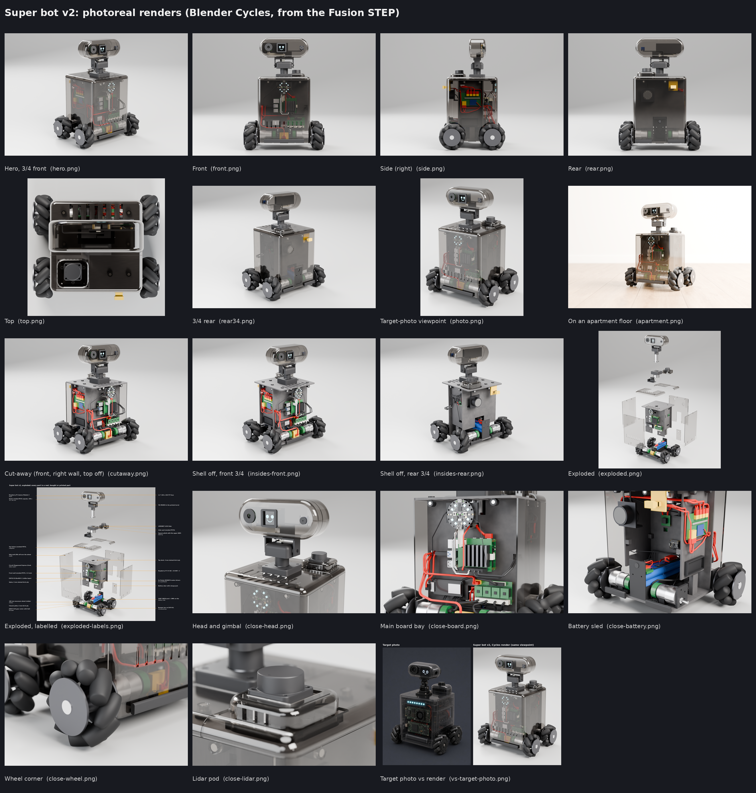

# Super bot v2: photoreal renders

Blender Cycles renders of the v2 Fusion design, made to show what the built robot will look like and what is inside it. Every image is at least 1920 px. [`contact-sheet.png`](contact-sheet.png) shows them all on one page.



## The images

- **Outside, studio:** `hero.png` (3/4 front), `front.png`, `side.png` (right), `rear.png`, `top.png`, `rear34.png` (3/4 rear).
- **At home:** `apartment.png`, on an oak floor against a wall, with daylight and shallow depth of field.
- **Inside:**
  - `cutaway.png`: front wall, right wall and top halves off.
  - `insides-front.png` and `insides-rear.png`: all shell panels off.
- **Exploded:** `exploded.png`, and `exploded-labels.png` with a callout for each part. The harness is left out of both, because cables between moved groups would float.
- **Close-ups:** `close-head.png` (head and gimbal), `close-board.png` (front bay: Pi 5 + AI HAT+ 2, CPX, motor drivers, ESP32-S3), `close-battery.png` (sled, pack, door), `close-wheel.png`, `close-lidar.png`.
- **Against the target:** `vs-target-photo.png` puts `docs/concepts/v2-target-photo.png` next to `photo.png`, rendered from the same viewpoint.

## What is real and what is approximated

- **Geometry:** the Fusion document "Super bot - v2", exported as STEP on 19 Nov 2026 after the wiring thread's push (`f6f2c9b`). That design is the off-the-shelf module version (no custom main board), with lidar option A and the Pi 5 in pose B. Every body is drawn at its CAD position.
- **Vendor models** replace the Fusion stand-ins:
  - Raspberry Pi 5 (Raspberry Pi Ltd STEP)
  - Camera Module 3 (Raspberry Pi STEP)
  - Circuit Playground Express and BNO085 (Adafruit CAD parts)
  - LDROBOT LD19 (LDROBOT STEP)

  Each one is aligned on its PCB or body to the stand-in. They are not committed here: they are large and the licences belong to the vendors. `cad/v2/render/fetch_vendor.sh` downloads them.
- **No vendor model exists** for the Pi Active Cooler or the AI HAT+ 2, so those keep the Fusion shapes.
- **Mecanum rollers:** in the CAD they are double cones, a modelling shortcut. The renderer swaps each one for a rubber barrel on the same axis, with the same length and largest diameter, because that is the shape real rollers have.
- **Materials:**
  - smoked translucent PETG (interior lit through the shell)
  - matte black printed PETG with 0.2 mm layer lines
  - dark-grey stained birch ply
  - green and black soldermask
  - brass standoffs, brushed aluminium and steel
  - rubber rollers
  - red and black silicone wire, and a light FFC ribbon

  The CPX NeoPixels and the TFT face glow, as the status light and the eyes. The colours are chosen for the look, not measured from samples.
- **Lighting:** a grey studio cyclorama with soft key, fill and rim lights, using the CC0 Poly Haven HDRI `studio_small_09`. The apartment shot uses Poly Haven's `lebombo` HDRI and `laminate_floor_02` texture, both CC0.

## How to rebuild

On the VPS:

```bash
cad/v2/render/fetch_assets.sh                     # HDRIs + floor texture -> ~/ops/sb-render-assets
cad/v2/render/fetch_vendor.sh                     # vendor STEPs -> /tmp/sbr/vm meshes
# STEP from Fusion (needs the Fusion lock): scripts/fmcp.py job shot-render-step "[('export.py', \"main(('step',))\")]"
~/tools/sb-ocp/bin/python -I cad/v2/render/step2mesh.py super-bot-v2.step /tmp/sbr/v2
~/tools/sb-ocp/bin/python -I cad/v2/render/validate.py /tmp/sbr/v2      # option A, harness, modules
heavy blender -b -P cad/v2/render/scene.py -- --mesh /tmp/sbr/v2 --vendor cad/v2/render/vendor.json \
      --out cad/v2/renders/real --shots hero,front,...                  # names in SHOTS in scene.py
python3 cad/v2/render/finish.py cad/v2/renders/real                     # labels, side-by-side, contact sheet
```

`~/tools/sb-ocp` is a venv with `cadquery-ocp==7.8.1.1.post1` and numpy. OCP 8.0 lacks the collection bindings. Each shot takes 6 to 12 minutes on 4 CPU cores at 128 samples with OIDN denoising. `render-log.txt` records any body whose name matched no material rule.
