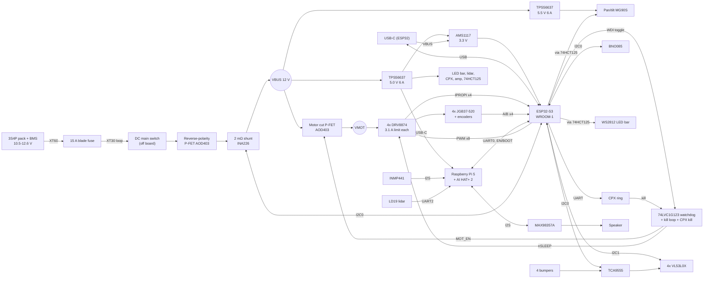

# Super bot main board, rev A

The main power and I/O carrier for Super bot v2: one 4-layer board that takes the battery, protects and measures it, makes every supply rail, drives the four wheels, and connects the Raspberry Pi 5 to everything else. The ESP32-S3 on it runs the motor and sensor reflexes. Designed in KiCad 10 on the VPS on 17-18 Nov 2026 by a Claude thread while Adam slept. Nothing has been ordered.

**Status (18 Nov 2026, 05:20 UTC): routed and checked.**
- **ERC:** 0.
- **DRC:** 0 violations and 0 unconnected items, with schematic parity 0. This is the full `kicad-check` gate: severity-all (warnings count), zones refilled, against JLC-safe rules (0.15 mm clearance, 0.10 mm minimum track, 0.3 mm minimum drill, 0.25 mm copper to edge).
- **Fab set:** the JLCPCB outputs, STEP and renders are in `out/` and `renders/`.

Read **Open questions** before ordering. The outline is provisional, and three rev A compromises are listed there.

## What's on it

- **Battery input:** XT60 (battery) → 15 A blade fuse → XT30 loop for the DC main switch (or loop key) → reverse-polarity P-MOSFET → 2 mΩ shunt → 12 V bus. TVS on the bus.
- **Battery monitor:** INA226 (I2C 0x40), 16 A full scale, for the time-left model and limp mode.
- **Hardware motor cut (no button):** a retriggerable one-shot only keeps the motors powered while the ESP32 keeps toggling a watchdog pin. An open kill loop or the CPX kill line cuts them too. The cut does two things: it puts all four drivers to sleep and switches off the motor supply with a high-side P-MOSFET.
- **Motors:** 4× DRV8874 in PWM mode. Each limits current at 3.1 A and reports it to an ESP32 ADC (0.82 V/A), and each has an encoder input with pull-ups and RC filters.
- **Rails:**
  - 5.0 V / 6 A for the Pi 5 and 5 V loads (TPS56637), out through a USB-C port.
  - 5.5 V / 6 A servo rail on its own TPS56637.
  - 3.3 V / 1 A logic (AMS1117), which also runs from the ESP32's USB port so you can flash with the battery off.
- **ESP32-S3-WROOM-1-N16R2:** USB-C for programming and debug, BOOT and RST buttons, UART0 to the Pi. The Pi can reset it and put it in bootloader mode itself.
- **TCA9555 I/O expander:** the slow lines (cliff XSHUTs, bumpers, IMU, ultrasonic trigger, fault and status lines).
- **5 V level shifting (74HCT125):** WS2812 LED bar data, both servo signals, ultrasonic trigger. The ultrasonic echo comes back through a divider.
- **Audio:** MAX98357A 3.2 W amp on the Pi's I2S, plus a connector for the INMP441 mic in the head.
- **Connectors:**
  - Pi GPIO (40-way IDC), Pi 5 V out (USB-C), ESP32 USB-C
  - battery XT60, main switch loop XT30
  - 4 motors (JST-XH 6)
  - 4 cliff sensors and the IMU (JST-SH, Qwiic pin order), 2 Qwiic ports (ESP32 bus, Pi bus)
  - bumpers (one PH-6 harness), LED bar, lidar LD19, CPX, kill loop, speaker, mic
  - pan and tilt servos (3-pin 2.54 mm headers), optional HC-SR04 header (not fitted)

## Block diagram

## Why these choices

**Scope (one carrier board, not a Pi HAT).** In the v2 body the Pi 5 + AI HAT+ 2 stands on the spine above this board, so a HAT can't sit on it. One board replaces six things in the v2 CAD: the perfboard driver board, the ESP32 cradle, the cheek power distribution board with its INA226 module, the Pololu Pi buck, the servo buck and the MAX98357A breakout. The Pi connects with two standard cables: a 40-way IDC ribbon from the HAT's pass-through header, and a short USB-C to USB-C cable for 5 V.

**4 layers, not 2.**
- **Layer stack:**
  - In1: an unbroken GND plane under everything (the ESP32 radio, four motor drivers and two 6 A bucks all want one).
  - In2: a split power plane (VMOT under the drivers, 3.3 V under the logic, VBUS as a feed strip, 5 V and the servo rail on the right).
  - Outer layers: signals plus F.Cu/B.Cu pours for the 15 A input path.
- **Why not 2 layers:** on 2 layers the motor and battery currents would share copper with the signal returns, and this many parts would not route in 186 × 70 mm.
- **Cost:** JLC charges roughly EUR 15-20 more for 5 boards of this size, which is small next to the assembly cost.

**Supplies.**
- **The bucks:** the approved Pololu modules (D36V50F5, D36V28F6) became two on-board TI TPS56637 (6 A synchronous, 4.5-28 V in, ceramic-stable D-CAP3).
  - **5 V rail:** it has real headroom for the Pi 5 in 5 A mode plus the LED bar, lidar and amp, and it sits right under the Pi's USB-C.
  - **Servo rail:** it runs on its own converter, so servo stalls never touch the Pi.
  - **Values:** taken from TI's table 4 (5 V: 3.3 µH; above 5 V: 5.6 µH).
  - **Parts and fees:** both rails use the same IC, so there is one Extended fee.
- **3.3 V:** a Basic AMS1117 from 5 V. Its input is diode-ORed with the ESP32's USB VBUS, so the ESP32 can be flashed with no battery and USB never back-feeds the 5 V rail.

**Hardware motor cut.** Adam decided there's no e-stop button on the body. The board still never lets the motors run on software alone:
- **The watchdog:** a 74LVC1G123 one-shot drives MOT_EN high only while the ESP32 keeps toggling WDI from its control loop, at more than 25 Hz (timeout ≈ R·C = 47 kΩ × 1 µF ≈ 47 ms). If the firmware hangs, resets or is being flashed, the motors stop.
- **What MOT_EN switches:** it drives all four DRV8874 nSLEEP pins (outputs go Hi-Z within µs) and the gate of a high-side AOD403 that disconnects VMOT. The FET has a soft turn-on (about 3 ms) so 940 µF of motor bulk capacitance never yanks VBUS.
- **Two more ways to cut:** opening the KILL LOOP connector (a normally-closed loop; fit a shorting plug, a remote-kill relay contact or an NC button later) and the CPX's KILL line.
- **Readback:** the ESP32 reads MOT_EN and the loop state through the expander.
- **Bench use:** JP1 is a solder jumper that bypasses the kill loop.

**Motor drivers.**
- **Mode and current limit:** DRV8874 in **PH/EN mode** (PMODE tied to GND): IN1 = EN (the PWM), IN2 = PH (direction); EN low brakes, nSLEEP low (the motor cut) coasts. PWM (IN/IN) mode was the plan, but PMODE on two drivers couldn't be routed to 3.3 V, and GND sits on the next pin. Firmware just uses the PH/EN truth table. ITRIP = VREF / (R_IPROPI × 455 µA/A) = 2.53 V / (1.8 kΩ × 455 µA/A) ≈ 3.1 A, above the 2.3-2.4 A stall of the 530 rpm JGB37-520, so a stall is limited but never chopped in normal driving.
- **Current sense:** IPROPI goes to ESP32 ADC1 (0.82 V/A) for the stall reflex. A 10 nF filter sits on each IPROPI line, as the datasheet suggests.
- **Fault line:** nFAULT is a wired-OR into the expander, for motors A and B only. Motor C and D nFAULT are left unconnected in rev A because their pins were boxed in during routing. Those drivers still protect themselves (overcurrent auto-retry, thermal shutdown, current limit), and the ESP32 still reads their current through IPROPI. Only the fault flag is missing.
- **Encoders:** they run from 3.3 V, with 10 kΩ pull-ups and 1 kΩ / 1 nF filters. The worst-case edge rate is about 1.8 kHz per channel.

**ESP32 pin budget.**
- **31 free GPIOs, all used:** 8 PWM, 8 encoder (PCNT), 4 ADC, two I2C buses, WDI, the expander INT, LED data, 2 servos, ultrasonic echo, and UART TX to the CPX.
- **Slow lines on the TCA9555:** 4 cliff XSHUTs, 4 bumpers (read on the INT edge, under 1 ms), IMU reset/INT, ultrasonic trigger, the fault/alert lines, MOT_EN and kill readback, and a status LED.
- **Strapping pins:** IO45/IO46 drive the servo buffers with 10 kΩ pull-downs so the chip always boots normally.
- **Module:** -N16R2, because the octal-PSRAM -R8 versions would eat GPIO35-37.

**Pi link.**
- **UART0 to the ESP32's UART0:** that is also its ROM bootloader port, and with GPIO23/24 driving EN and BOOT through 2N7002s the Pi can reflash the ESP32 with esptool, no USB cable needed.
- **Lidar:** the LD19 goes to the Pi's UART2.
- **Audio:** I2S goes to the amp and the mic.
- **I2C:** the Pi's I2C1 has its own Qwiic port; the ESP32 owns its own two buses, so there's no multi-master.
- **Series resistors:** 1 kΩ on every cross-power-domain line stops back-powering when only one side is on.

**Level shifting.** Only where 5 V parts need it:
- **Into 5 V parts:** a 74HCT125 (TTL thresholds, 5 V supply) drives the WS2812 bar, both servo signals and the ultrasonic trigger.
- **From the ultrasonic:** the HC-SR04 echo comes back through a 10k/20k divider.
- **Everything else:** VL53L0X, BNO085, LD19, INMP441, the CPX and the Pi are 3.3 V parts, so they connect directly.

**Parts policy.**
- **Basic first:** every resistor, ceramic capacitor, LED, diode, small FET, switch and the LDO is a JLC Basic or Preferred part (no fee).
- **Extended parts:** these are the ICs, connectors, inductors, shunt and power FETs, for which no Basic part exists.
- **Stock:** every line was checked for stock at more than twice the 5-board need. See the cost table.
- **Footprints:** the module, buck, XT60/XT30, fuse holder, box header, inductors and switches use easyeda2kicad footprints from the LCSC part (so JLC's placement matches); everything else uses KiCad's standard footprints.

## Files

- **Ordering:**
  - `out/JLCPCB/main-board-_JLCPCB_compress.zip`: Gerbers + drill (upload this).
  - `out/fab/jlcpcb/main-board_bom_jlc.csv`: BOM with LCSC numbers.
  - `out/fab/jlcpcb/main-board_cpl_jlc.csv`: placement (CPL).
- **Views:**
  - `renders/pcb-3d-top.png`, `pcb-3d-bottom.png`, `pcb-3d-iso.png`: ray-traced 3D views.
  - `renders/pcb-front.png`, `pcb-back.png`: copper, mask and silkscreen per side.
  - `renders/main-board.step` and `out/3d/main-board-3D.step`: 3D model for Fusion.
- **Schematic:**
  - `renders/main-board-schematic.pdf` / `out/docs/`: schematic, all 10 sheets.
  - `renders/*.png`: one PNG per sheet.
- **Checks:** `reports/main-board-erc.json`, `reports/main-board-drc.json`, `reports/cost.txt`.
- **Sources:**
  - `main-board.kicad_pro` / `.kicad_sch` (root + 6 sheet files) / `.kicad_pcb`: open these in KiCad 10 on the Mac.
  - `lib/`: the project symbol library, footprints and 3D models (self-contained, no global libraries needed except KiCad's own).
  - `gen/`: the generator scripts (below).
  - `jlcpcb.kibot.yaml`: KiBot config for the fab outputs.

## Board

- **Outline and holes:** 186 × 70 mm, 1.6 mm, 4 layers (JLC04161H-7628 stackup), HASL lead-free. 4× M3 plated mounting holes tied to GND. A 24 × 8 mm notch in the top edge leaves room for the cable going into the Pi 5's USB-C port.
- **Where it sits in v2:** flat on spine standoffs in the front chimney, between the front motors (top about z 69) and the Pi 5's bottom edge (z 140). Viewed from the front, the battery/power end is on the robot's right.
- **Provisional:** the outline and hole positions stay provisional until the v2 CAD is final. The CAD still shows the old perfboard and cradle, so it needs a matching board block.
- **Top side only:** all components are on the top, for one-sided JLC assembly. The through-hole parts (XT60, XT30, fuse holder, box header, motor XH, servo headers) need JLC's through-hole soldering.
- **Layers:**
  - F.Cu: parts, signals, and pours for the input chain, VBUS and VMOT.
  - In1: solid GND.
  - In2: split power plane, with VBUS (left and a feed strip), +3V3 (logic area, an encoder band under the motor connectors, and a bridge), VMOT (a 14 mm band under the drivers), +5V (right side up to the Pi USB-C) and VSERVO (under the servo buck and headers).
  - B.Cu: signals, the parallel input-chain pours, the VBUS feed to the bucks, and GND fill.
- **Copper and thermal:**
  - Each DRV8874 exposed pad has 6 thermal vias (0.3 mm drill) into the GND planes.
  - Both MOSFETs sit in their own full-connection pours on both outer layers, stitched with via grids.
  - Every IC has local decoupling. Supply pads that sit over their plane get their own via.
- **Silkscreen:** every connector is labelled (on the four motor XH connectors the label sits along the front lip of the connector's own footprint, the only free spot) (MOTOR A FL ... BATTERY 12V, MAIN SWITCH LOOP, PI 5V OUT, ESP32 USB, PI 5 GPIO, CLIFF F/R/B/L, IMU, QWIIC ESP/PI, BUMPERS, LED BAR, KILL LOOP, LIDAR, CPX, MIC, SPEAKER, PAN, TILT, SONAR, FUSE 15A). Small passives carry their references on the fab layer only, to keep the silkscreen readable.

## Trace widths (IPC-2221, 1 oz outer, 0.5 oz inner)

`python3 gen/calc.py` prints these. The ΔT columns are the temperature rise of the copper.

| Path | Current | Needed on 1 oz outer (ΔT 20 °C) | What the board has |
| --- | --- | --- | --- |
| Battery input chain (fuse rating) | 15 A | 8.3 mm | F.Cu + B.Cu pours in parallel, about 5-8 mm each (10-16 mm total) |
| Same, realistic worst case (4 stalls + Pi) | 12.3 A | 6.3 mm | same |
| VBUS from the shunt to the motor-cut FET | 10 A | 4.7 mm | 7.8 mm channel on F.Cu and B.Cu |
| VMOT to the drivers (normal driving) | 4 A | 1.3 mm | pours at the FET, then a 14 mm In2 band (6 A at ΔT 20 °C, 7 A at 30 °C) |
| One motor output (current limit) | 3.1 A | 0.94 mm | 1.0 mm, with a 0.4 mm neck for 1.1 mm at the 0.65 mm-pitch pin |
| VBUS feed to both bucks | 3.8 A | 1.24 mm | 1.5 mm B.Cu feed, 0.8 mm drop to each VIN, plus a local VIN pour |
| +5 V to the Pi | 6 A | 2.3 mm | In2 5 V plane, 18-37 mm wide (7 A at ΔT 20 °C), plus a pour and 4 vias at the Pi USB-C |
| Servo rail | 2 A | 0.5 mm | In2 servo plane |

Honest limits:
- **VMOT band:** 10 A (all four motors stalled at once) would need 28 mm of 0.5 oz inner copper. The band is 14 mm. That's fine because stalls are limited to 3.1 A per motor by the drivers and cut by the ESP32 within 0.5 s, so the full 10 A only lasts for moments.
- **Thin power stubs:** a few decoupling-capacitor and divider connections on the power nets (VMOT, VBUS, +5V) are 0.5-0.6 mm tracks drawn by the last-mile router. None of them carries a main current.

## Ordering at JLCPCB

1. Upload `out/JLCPCB/main-board-_JLCPCB_compress.zip` as the Gerber.
   - Set 4 layers, 1.6 mm, JLC04161H-7628 impedance stack (or "no requirement").
   - Choose HASL lead-free, green or black mask, 5 pcs.
2. Turn on PCB Assembly: standard, top side, 5 boards.
   - Upload `out/fab/jlcpcb/main-board_bom_jlc.csv` (BOM) and `main-board_cpl_jlc.csv` (CPL).
3. In JLC's placement preview, check the rotation of:
   - the ESP32 module (antenna end flush with the top edge, over the copper keepout)
   - both TPS56637 (pin 1 dot)
   - the DRV8874s, USB-C connectors, the INA226, TCA9555, 74HCT125 and 74LVC1G123
   - the electrolytics (stripe = minus)
   - the SMBJ15A TVS diodes (band toward VBUS/VMOT)
4. Through-hole parts (XT60, XT30, fuse holder, box header, motor XH, servo headers): choose JLC's THT soldering, or leave them out and solder them yourself.
5. The optional HC-SR04 header (J415) and the kill-loop solder jumper (JP201) are not fitted.
6. PCBWay takes the same Gerber zip. Its BOM needs the columns Designator, Qty, MPN and Package: build it from `out/fab/jlcpcb/main-board_bom_jlc.csv` (LCSC numbers are in the BOM).

## Cost estimate for 5 assembled boards

`python3 gen/cost.py 5` prices every BOM line at the 5-board quantity from the JLC catalog snapshot, or the live LCSC API for the ESP32 module, and checks that stock is at least twice the need.

| Item | USD | EUR |
| --- | --- | --- |
| PCB: 5× 186 × 70 mm, 4-layer, 1.6 mm, HASL (JLC quote estimate) | 32 | 29 |
| Parts: 65 BOM lines, 225 placed parts per board | 157 | 145 |
| Assembly: setup + stencil + 675 SMT and 82 THT joints per board | 38 | 35 |
| Extended part fees: 27 × $3 | 81 | 75 |
| Shipping to Hungary (estimate, before VAT and customs) | 20 | 18 |
| **Total for 5 assembled boards** | **328** | **≈ 300 (about 60 per board)** |

Assumptions:
- USD → EUR at 0.92.
- Prices are from the 17 Nov 2026 snapshot. Check the final number in JLC's quote.
- Hungarian VAT (27 %) and any customs fee are on top.

Biggest costs:
- the four DRV8874s ($17.6)
- the two TPS56637s ($22.5)
- the ESP32 module ($26.4)
- Extended part fees

Going cheaper:
- Swap the TI SN74LVC1G123 for the JSM clone (C53114387, saves about $7).
- Do the through-hole soldering yourself.

## Open questions for Adam

0. **Rev A compromises, all small, chosen to finish the routing:**
   - The DRV8874s run in PH/EN mode, not PWM mode.
   - Motor C/D nFAULT is not wired.
   - The motor-cut gate pull-up R207 sits next to C206.

   All three are in the schematic, so schematic and board match. Rev B can route nFAULT C/D if the board grows by about 5 mm or the passives move to the bottom side.
1. **On-board bucks instead of the Pololu modules.** The approved D36V50F5 / D36V28F6 modules are replaced by two TI TPS56637 on the board. OK? Going back means adding two 3-pin headers and deleting the buck blocks.
2. **v2 CAD fit.** The board is 186 × 70 mm, from the front motors (z ≈ 70) up to the Pi's bottom edge (z = 140). The Pi's USB-C cable needs the notch and a right-angle plug: either use a short right-angle USB-C cable, or raise `pi_z0` by about 8 mm in v2. The v2 CAD still shows the perfboard, the ESP32 cradle, the cheek PDB/INA226, the Pololu bucks and the amp breakout; all of those are now on this board.
3. **Fuse.** v2 puts a 15 A blade fuse on the pack and this board has one too. Keep both (harmless) or drop the pack one? Check which blade size the XF-506P holder takes (standard ATO/ATC is expected; the LCSC datasheet is an image) before buying fuses.
4. **Motor and encoder wiring.** J601-J901 follow the common JGB37-520 6-wire order: M+, GND, A, B, VCC, M-. The encoders run at 3.3 V. Check this against the motors you buy, and that their Hall sensors work at 3.3 V (most do; if not, it's a small change).
5. **XT60 polarity.** The board takes pad 2 as + (the footprint's silkscreen mark). Reverse-polarity protection means a mistake won't damage anything, but check against the real part before soldering cables.
6. **Kill loop.** It's normally closed. With nothing plugged in, the motors stay off (fail-safe). Fit a shorting plug, or bridge JP201 on the bench. Do you want a remote kill or a button on it later?
7. **Pi 5 power.** A USB-C to USB-C cable rated 5 A, or a short right-angle 3 A one, from PI 5V OUT. Set `usb_max_current_enable=1` in config.txt. The port advertises 3 A (Rp = 10 kΩ) and can't do USB-PD.
8. **Second ESP32.** There's no footprint for one. The Qwiic port on the ESP32's I2C1 and the Pi's UARTs leave room for later. OK?
9. **Speaker and mic.** MAX98357A gain is 9 dB into 4 Ω, and the mic is on the left I2S channel. Check that the head's 6-wire mic cable through the neck works at about 3 MHz BCLK (33 Ω terminations are fitted).
10. **Bench checks before trusting the watchdog:** the one-shot timeout (≈ 47 ms) and that the ESP32 firmware toggles WDI at 100 Hz or more.

## Not verified

- No SPICE or thermal simulation. The buck values follow TI's tables.
- The current-limit, watchdog and motor-cut behaviour are calculated, not tested on hardware.
- **Routing:** it was done by Freerouting plus small custom helpers (`gen/fixup.py` grid router, `gen/ripup.py`). A few last-mile links are 0.15 mm tracks, and some cut through the F.Cu copy of a power pour (its B.Cu twin carries the current). DRC passes, but have a human look over the copper in KiCad before ordering, especially around the motor drivers and the bucks.
- The JLC placement rotations are untested until the online preview.
- The 3D models for the module, buck, XT60/XT30, fuse holder, box header, inductors and switches come from LCSC/EasyEDA. The other parts use KiCad's library models.
- Fit in the v2 body is checked against `cad/v2/README.md` parameters only. The CAD isn't updated (another thread owns Fusion).

## How it was made (and how to change it)

Everything is generated from Python, so a change is an edit plus a re-run, not hand-editing KiCad files:

1. `gen/design.py` holds the whole circuit: every part, its LCSC number and its nets, one function per sheet. `gen/symbols.py` makes the project symbols KiCad lacks (DRV8874, TPS56637, AOD403 with DPAK numbering, XT60/XT30 with mount pins, MAX98357A with the pad typed passive).
2. `gen/build_sch.py` writes the hierarchical schematic (root + power, motor cut, MCU, I/O, audio, and one motor-channel sheet used four times) and the project file with the net classes.
3. `gen/build_pcb.py` builds the board from the netlist. It hand-places the key parts (connectors, ICs, power parts) and packs each part's passives around the pin they connect to, inside that block's area.
4. `gen/route.py` draws the planes and power pours. It also draws the locked high-current tracks (motor outputs, buck SW nodes, VBUS feed, driver VM vias, exposed-pad thermal vias) and places its own via fanout for every supply pad that sits over its plane. Then it exports Specctra DSN (inner layers as planes), runs Freerouting 2.5, imports the result and fills the zones. `--continue` re-runs Freerouting on an already-routed board.
5. `gen/patch.py` makes targeted copper fixes after routing: the +3V3 In2 bridge, buck VIN pours, the Pi USB-C 5 V pour and vias, and the buck AGND-PGND ties.
6. `gen/fixup.py` is a small grid A* router (0.05 mm grid, F.Cu/B.Cu plus vias) for the last connections Freerouting leaves open.
7. `gen/clean_loop.sh` runs `gen/cleanup.py` until nothing changes. It removes dangling or duplicate vias and dangling stubs. pcbnew's Python API breaks after `Remove()`, so it runs one round per process.
8. `gen/finish.py` places the connector labels where they don't hit copper or other silk, and trims footprint silk segments that land on pads or the edge (they move to the fab layer). Because of that trim, `lib_footprint_mismatch` is set to ignore in the project; every manufacturing check stays at its default. It also writes the JLC04161H-7628 stackup.
9. `gen/cost.py` re-checks stock and prices every BOM line; `gen/calc.py` does the trace-width maths.

Run them in that order from `hw/main-board` (route, then patch, fixup, clean_loop, finish, clean_loop) with `~/tools/kicad-mcp-server/.venv/bin/python` (it has `sexpdata` and pcbnew). Then use the helpers: `kicad-check main-board.kicad_pcb`, `kicad-render main-board.kicad_pcb`, `kicad-jlc .`.
